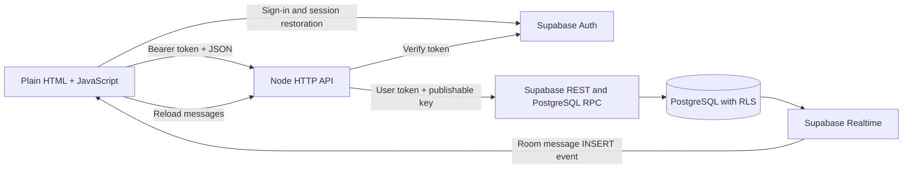
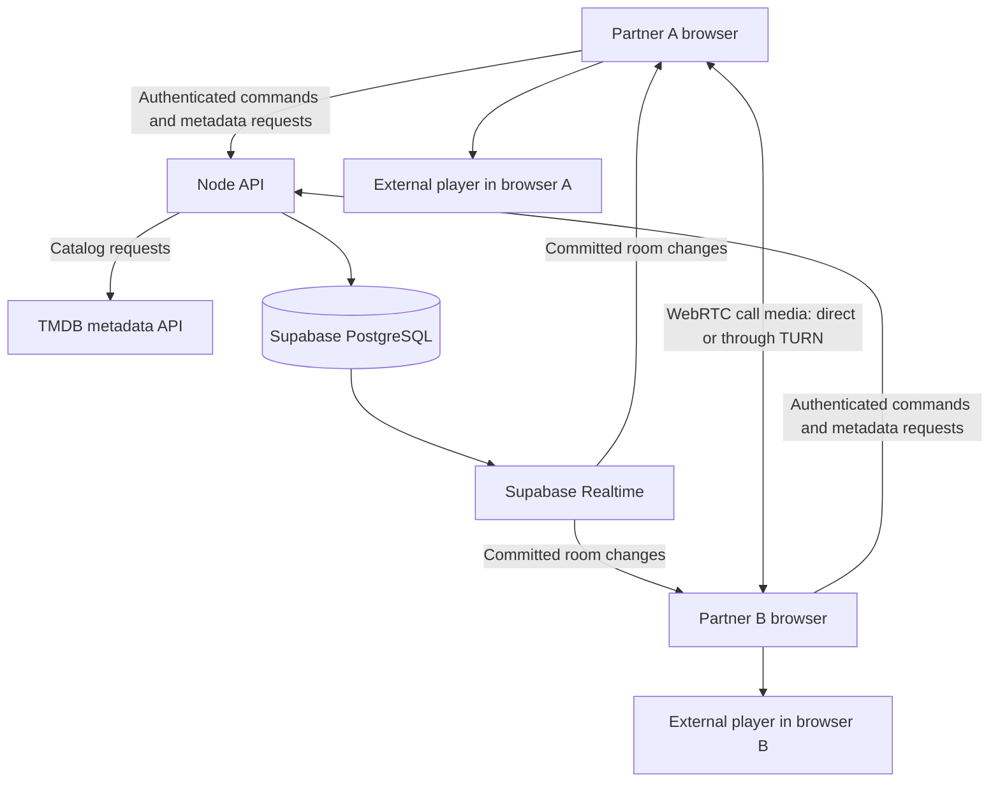

# Multiplay — watch-together-anything

A watch-together app for couples. Many couples can use the system; each private room has **at most two members**. User IDs are added through room creation and invitation, never hard-coded in the schema. An account can currently belong to multiple rooms.

This is a working development backend with a plain HTML starter. Authentication, profiles, rooms, invitations, saved/live chat, TMDB discovery, and shared room lists are implemented. Movies and selected TV episodes can now open in CinemaOS with VidLink fallback in the current browser. Shared playback state and CinemaOS synchronization are implemented; real two-browser stream validation, watched tracking, and calls remain outstanding.

Read first: [Why TMDB?](#why-tmdb-is-part-of-this-project) · [Complete target design](#complete-target-design--planned-features) · [Local setup](#setup-from-a-fresh-clone) · [Implemented APIs](#implemented-http-api) · [Remaining work](#remaining-work-and-suggested-order)

## Requirements and implementation status

The intended experience lets both partners control playback, maintain a shared movie/show list, chat or call, and move titles to Watched after finishing together. Episode progress must be distinguished from completing a series. Development aims to use free services; production cost and capacity are not established.

| Feature | Status | Notes |
| --- | --- | --- |
| Plain HTML starter | Done | No CSS or build step; visual design is left to the frontend developer. |
| Local demo | Done | In-memory catalog, list, room state, and chat for frontend work with Node off; resets on reload. |
| Email/password sign-in | Done | Supabase session restoration/refresh; Node verifies access tokens. |
| Editable profiles | Done | Display name and avatar persist in PostgreSQL. |
| Room creation/invitation | Done | Database functions create membership; trigger enforces two members per room. |
| Joined-room list/selection | Done | Member-only list; connection and selection preferences use local storage. |
| Saved text chat | Done | Latest 100 messages; verified sender; duplicate client message IDs ignored on retry. |
| Live chat | Done | Room-filtered Supabase Postgres Changes events trigger message reloads; manual refresh remains available. |
| TMDB browsing/search | Steps 1–3 implemented | Browsing/search, posters, pagination, title details, season/episode selection, and loading/error states. Playback remains separate work. |
| Shared movie/show list | Implemented; live database validation pending | Room-scoped add/read/remove, duplicate protection, canonical TMDB snapshots, and member-only live updates. |
| Shared playback | Implemented; live validation pending | Persisted sessions, member commands, safe retries, Realtime, polling, and CinemaOS drift correction. |
| Embedded playback | Implemented; streams unconfirmed | CinemaOS shared controls after video readiness; VidLink fallback with manual controls. |
| Watched completion | Pending | Needs both-member confirmation, episode progress, and undo. |
| Voice/video | Pending | No WebRTC signaling or STUN/TURN setup. |
| Public signup/recovery | Pending | Only sign-in UI exists; create test accounts in Supabase Dashboard. Check project signup settings separately. |
| Production deployment | Pending | Node listens only on 127.0.0.1:3000. |

## System design



- **Frontend:** index.html with inline JavaScript and the Supabase browser SDK from jsDelivr. Local demo stays available for independent frontend work.
- **Backend:** Node native http, fetch, fs, and path; CommonJS modules. The installed dependency is @supabase/server for token verification. No framework or ORM.
- **Database:** Supabase PostgreSQL. Node forwards the user's token to REST/RPC calls, so Row Level Security (RLS) applies. This implementation does not use a service-role/secret key.
- **Realtime:** Browser subscriptions listen for inserts in the selected room. Events cause an authenticated API reload; PostgreSQL retains the messages. RLS controls readable records.
- **Catalog:** Node proxies TMDB popular movie/TV lists, search, title details, and TV seasons/episodes with a server-only token. Browse renders posters, pagination, and a details panel.
- **Playback:** PostgreSQL stores room state; shared-playback.js applies updates through player.js. WebRTC calls remain planned.

### Main flows

1. **Sign in:** Supabase Auth supplies a session. /api/me verifies it and reads or creates the user's profile. Requests retrieve the current session rather than retaining an expired token.
2. **Create room:** Node calls create_watch_room. One database transaction creates the room, generates a random 12-character invite code, and adds the creator as a member.
3. **Join room:** join_watch_room finds the code and locks the room row before inserting membership. A trigger uses a transaction lock and count to enforce the two-member limit.
4. **Send chat:** Node checks membership, derives sender ID from verified claims, reads their name, validates text, and inserts it. The combination of room ID, sender ID, and client message ID prevents duplicate inserts on retry.
5. **Receive chat:** A Realtime event triggers an API fetch. Room changes/sign-out remove the old subscription. Generation/request checks prevent stale responses from replacing another room's chat.

## Why TMDB is part of this project

Think of the app as three connected pieces: **a catalog to choose something, a player to watch it, and a private room to experience it together**.

| Responsibility | Service/component | Example |
| --- | --- | --- |
| Find and describe a title | TMDB, through our Node API | Search for a title, read its details, and choose a TV season/episode |
| Save the couple's choices and activity | Supabase PostgreSQL | Shared list, chat, membership, playback session, completion confirmations |
| Show the video | CinemaOS primary and VidLink fallback | Each browser loads its own stream |
| Keep both partners coordinated | Backend, database, Realtime, and player adapter | Commit room state and apply it to CinemaOS players |
| Carry a voice/video call | Browser WebRTC — planned | Camera/microphone between the two partners |

### What TMDB gives the frontend

TMDB supplies catalog metadata and images. The integration uses popular lists and search for movie/show names, poster references, summaries, dates, and identifiers. Details include genres, status, movie runtime, and TV seasons/episodes. Browse uses real results in Backend API mode and keeps the sample catalog in Local demo. See [TMDB's introduction](https://developer.themoviedb.org/docs/getting-started) and [search-to-details workflow](https://developer.themoviedb.org/docs/search-and-query-for-details).

A shared-list item should refer to a title using `(mediaType, tmdbId)`, such as `('movie', 155)`, instead of treating a typed title as its identity. Movie and TV IDs are separate namespaces, so store the type too. For an episode, also store season and episode numbers. This avoids ambiguity between remakes, translations, and titles that share a name.

TMDB is our chosen catalog source, not a requirement of Node, Supabase, or synchronized playback. A minimal manually entered video-link app could work without it. We want browsing, search, posters, TV episode selection, and consistent identities across saved lists, so a catalog service avoids building and maintaining those records ourselves. Another catalog source could replace it behind our backend's normalized API.

### What TMDB does not give us

TMDB is not our movie streaming server. Its catalog does not make a full movie playable, establish streaming rights, guarantee an external provider has a matching video, or synchronize two players. Video-related metadata and trailers must not be mistaken for full-film hosting. The goal of broad movie coverage means searching the available catalog; we cannot promise literally every title or playable availability for every result.

CinemaOS is the primary embed provider; VidLink is the fallback. In Backend API mode, Watch creates a shared room session. CinemaOS receives documented play/pause/seek/getStatus commands. Shared controls wait for video status; VidLink supports manual playback only. See the playback acceptance check below.

### TMDB request flow

1. Browser requests `/api/search?type=movie&q=...&page=1`, or `/api/catalog?type=tv&page=1` for browsing.
2. Node validates parameters and calls TMDB with `TMDB_READ_ACCESS_TOKEN` from its environment. The token is never sent to browser code.
3. Node normalizes TMDB's movie/TV response fields to our title shape: ID, type, title, year, overview, poster reference, and pagination information.
4. The frontend renders title cards, posters, page navigation, and details. Adding a title now saves its identity and a small metadata snapshot in the selected room's list; the catalog is not copied into Supabase.
5. Watch saves the title/episode to the selected room and opens CinemaOS. The partner clicks Join playback. Provider changes apply to both joined clients.

Step 1 implements catalog/search, parameter validation, a 10-second upstream timeout, safe error messages, upstream rate-limit handling, and a 60-second in-memory metadata cache capped at 100 entries. Authentication runs before cache reads. No arbitrary upstream URLs are accepted.

Step 2 adds poster rendering and Previous/Next navigation to Browse. Images load lazily from TMDB's image CDN at `w185`, following [TMDB's image URL format](https://developer.themoviedb.org/docs/image-basics); missing/failed images show “Poster unavailable.” Search submission starts at page 1. Navigation keeps the last submitted type/query even if the inputs have been edited. Buttons are disabled while loading and at page boundaries. Loading, empty, and error states appear beside Browse. Failed requests keep previous results; older responses cannot replace a newer search or results after reconnect/sign-out. Local demo stays available with its existing single-page samples. The required TMDB notice is displayed; an approved TMDB logo is still needed before publishing.

To check step 2, hard-refresh `http://127.0.0.1:3000/`, sign in, choose Backend API, leave Backend origin blank, and Connect. Submit an empty Movie search to browse popular titles, use Next/Previous, then search for a movie or TV show and confirm the page resets to 1. Verify posters, page boundaries, and no-result searches. Switch to Local demo and confirm sample browsing still works. Add uses the shared list; Watch creates a shared session in Backend API mode.

Step 3 adds a Details button to every title card. The panel shows the overview, genres, release year, status, and movie runtime. TV titles load seasons from TMDB, including specials (season 0); selecting a season fetches its episodes. Episode selection shows the name, summary, air date, and runtime when available. Metadata can include future episodes and does not guarantee playable availability. Opening another title, closing details, reconnecting, or signing out invalidates pending responses. Failed season requests have a Retry button. Episode selection belongs to the opened show; Watch together on another show opens that show's details first. Local demo uses explicitly labelled sample seasons/episodes.

To check step 3, restart Node and hard-refresh the page. Connect in Backend API mode, search for a movie, and open Details. Then search TV for Breaking Bad, open Details, switch seasons, and select an episode. Confirm the episode text changes. Try switching titles/seasons while requests load, closing details, and Local demo. Detail selection stays local until Watch is clicked. The catalog needs no migration; shared playback requires backend/playback.sql.

TMDB's developer API is free for noncommercial use with attribution; commercial use needs separate arrangements. Before publishing, include an approved TMDB logo and the required notice: “This product uses the TMDB API but is not endorsed or certified by TMDB.” Review current terms if the app starts generating revenue. [TMDB FAQ and attribution requirements](https://developer.themoviedb.org/docs/faq)

## Complete target design — planned features

This section explains the intended end-to-end system. The implementation table above remains the source of truth for what currently works. Details introduced here are proposals for the remaining work, not promises that corresponding tables or routes already exist.

### Technology choices and responsibilities

| Layer | Choice | Why it fits |
| --- | --- | --- |
| Frontend | Plain HTML/JavaScript starter now; final styling owned by the frontend developer | Easy to inspect and use API endpoints without a build pipeline. No CSS has been supplied intentionally. |
| HTTP API | Node.js native HTTP server | Small backend, already running; validates requests and coordinates authenticated database/provider calls. |
| Identity | Supabase Auth | Account/session lifecycle; each person has their own identity. |
| Durable state | Supabase PostgreSQL with RLS | Transactions, room membership, saved lists, messages, progress, and authoritative playback snapshots. |
| Change delivery | Supabase Realtime | Notify the selected room's clients about committed state changes. It does not replace persistent state. |
| Catalog | TMDB through Node | Browsing, search, posters, title details, season/episode selection, and consistent title IDs. |
| Playback | CinemaOS adapter implemented; live verification pending | Each browser plays its own stream; the backend coordinates controls |
| Calls | Native WebRTC and authenticated signaling — planned | A two-person room can use one peer connection; add STUN/TURN connectivity as needed. |
| Source collaboration | GitHub/GitHub Desktop | Share code and documentation. Git synchronization does not migrate a Supabase database or copy local environment files. |

No Redis, Kafka, separate signaling framework, or group-call media server is needed for the initial two-person-per-room design. Reassess only when measured requirements justify more infrastructure. Specific hosting providers and production resource sizes have not been chosen.



### Accounts, invitations, membership, and presence

People can sign into the app with valid accounts. Room access additionally requires membership: being signed in must not grant access to every couple's chat, list, or playback session. Room creation inserts the creator's membership; an invited partner joins the same room. Each room is independent of other couples' rooms.

The capacity rule means two distinct member accounts, not two WebSocket connections. A partner opening a second tab must not consume a third membership slot. Joining an already joined room should be idempotent; the known trigger/ON CONFLICT issue below needs correcting. Invite lookup, membership insertion, and capacity enforcement must remain transactional.

Membership and presence are different. Membership is the durable permission to access the couple's room. Presence means currently watching/connected/ready and expires when a connection disappears. Leaving a watch session should not silently delete room membership, shared lists, or chat. Permanent room departure, deletion, invite rotation, and account recovery need explicit product flows.

For a public couples app, add frontend signup, email confirmation/recovery, invitation abuse controls, and production URLs. The existing manual account-creation setup is a development shortcut. Do not add a global hard-coded allowlist of our two personal user IDs.

### Shared list and TV progress

Use room-scoped data, rather than a global list or the current null groupId placeholder. A proposed list item has room ID, media type, TMDB ID, added-by user, timestamps, and a status such as Planned/Watching/Watched. Uniqueness on room + media type + TMDB ID prevents duplicates. Store small metadata snapshots only where useful; TMDB remains the catalog source.

Both partners can add/remove items. Every mutation checks room membership, commits to PostgreSQL, and notifies the room so both views update. Reconnecting fetches the saved list again. Private lists from different rooms must never mix.

For a TV show, store per-episode progress separately using show ID, season, and episode. Completing one episode does not complete the series. Agree how to handle new seasons and newly released episodes before declaring a whole show Watched.

### Shared playback state and command flow

Both partners have equal play/pause/seek/provider control. The backend/database is the authority for room state. Realtime messages notify clients of accepted state; clients must not treat an unauthenticated browser message as authority.

The implemented playback snapshot contains room ID, session ID, media identity, season/episode if applicable, provider, playing/paused status, position at an anchor time, server anchor timestamp, and an increasing revision. Presence/readiness and connection state should be modeled separately from the saved list and membership.

1. A partner chooses a title/episode or presses a shared control.
2. Browser sends a command ID, session ID, expected revision where appropriate, action, and validated arguments.
3. Backend authenticates the sender, checks room membership/current session, validates the action, and applies it in a database transaction.
4. A unique command ID makes retries safe. Locking or revision checks serialize simultaneous commands; stale commands are rejected and return the current state rather than changing a newer session.
5. Committed state gets a new revision and server timestamp. Realtime notifies both clients; each applies newer revisions and ignores older snapshots.
6. A newly connected client fetches current state instead of expecting to receive every historical event.

For playing media, compute the intended position as anchor position plus elapsed server time. For paused media, keep the anchor position. For example, a playing snapshot anchored at 100 seconds five seconds ago implies approximately 105 seconds now. Correct for client/server clock offset and network delay rather than trusting each browser's wall clock equally.

A provider adapter should expose load, ready, play, pause, seek, position/status reporting, error, and ended capabilities. Apply state after the player is ready, handle browser autoplay restrictions with an explicit user action, and prevent remote changes from being echoed back as new commands. Measure drift and tune correction thresholds during two-device testing; no synchronization latency guarantee exists yet.

If one partner buffers, the app needs an explicit policy (proposed initial behavior: pause together until both are ready). Presence loss should show disconnected/reconnecting and preserve the session. Reconnects load the latest snapshot, not an old locally cached position.

### Critical external-player limitation

A cross-origin iframe cannot be controlled simply by inspecting its internal video element. postMessage communication only helps if the embedded player supports the commands/events we send. Outgoing messages need an exact target origin; incoming messages must validate origin, source window, and payload. [Browser cross-origin communication](https://developer.mozilla.org/en-US/docs/Web/API/Window/postMessage)

Before claiming watch synchronization works, verify both the primary and fallback provider on real browsers for play, pause, seek, readiness, timing feedback, and native-control events. If a provider has no supported control API, a synchronized state database alone cannot control its video. Disable unsupported shared controls and explain the limitation; do not label that playback as synchronized.

Provider switching should pause the shared session, preserve title/episode and intended position, load the replacement on both sides, wait for readiness, and then resume by an agreed action. Confirm providers use compatible media/episode identifiers and timelines. Playback availability and external provider behavior remain dependencies outside our application's control.

### Finished together and Watched

The selected requirement is finishing together, not “one person clicked play” or “one player emitted ended.” Store completion confirmations scoped to the exact playback session, media version, member user ID, and episode if applicable. Repeated confirmation from one user must not count as two people.

When both current room members confirm the same session, commit watched/progress records and the list transition in one transaction. Show a waiting-for-partner state after the first confirmation. An ended event may prompt confirmation but should not unconditionally mark a title Watched. Changing title/episode or creating a new session must not reuse confirmations from an earlier one. Undo should make an explicit correction that both clients see.

### Text, voice, and video communication

Saved text chat is already implemented. PostgreSQL stores messages, the API checks membership and sender identity, and Realtime prompts the current room to reload. Future additions include older-message pagination, visible delivery/reconnect state, and message retention/deletion choices.

Voice/video calls are planned with browser WebRTC. Each participant grants camera/microphone permission. The peers exchange offer/answer descriptions and ICE connectivity candidates over an authenticated, room-scoped signaling channel, which could use Supabase Realtime. Call signaling is not the same as durable chat or the film's playback stream. [WebRTC peer connections and signaling](https://webrtc.org/getting-started/peer-connections)

WebRTC does not charge an API license fee. STUN helps discover network connectivity; when a direct connection cannot be established, TURN relays call traffic. A TURN server may be self-hosted (for example with coturn) or purchased as a service, but its compute and bandwidth still need funding. Two people allow direct peer calls without adding a group-call SFU, but do not eliminate TURN requirements. Do not promise reliable calls on every network with zero relay capacity. [WebRTC TURN guidance](https://webrtc.org/getting-started/turn-server)

Signaling must be restricted to the room members and a specific call ID, expire after the call, and handle simultaneous offers, denial of permissions, reconnection, mute/camera controls, and hangup. Camera/microphone tracks must stop on hangup or leaving the call. The proposed app does not record calls or forward movie video through WebRTC.

### Proposed remaining data and API boundaries

These are design proposals, not installed schema or implemented routes. Keep authoritative operations transactional and apply RLS on every room-owned table.

| Proposed data | Responsibility |
| --- | --- |
| Room list items | Planned/Watching/Watched title identity and room ownership |
| Episode progress | Watched episodes and progress independently of whole-show status |
| Playback sessions / current state | Shared title, episode, provider, position anchor, status and revision |
| Applied commands | Retry deduplication and ordering of accepted playback mutations |
| Session completion confirmations | One confirmation per member for the current session/media |
| Call/presence state | Short-lived room readiness, call IDs, participants and signaling |

The implemented catalog endpoints are GET /api/catalog, GET /api/search, GET /api/titles/{movie|tv}/{tmdbId}, and GET /api/titles/tv/{tmdbId}/seasons/{seasonNumber}. New shared-list APIs should be room-scoped. Playback needs snapshot, media selection, control, and presence endpoints; completion needs confirm/undo operations. Call signaling may use authenticated Realtime rather than a REST route per ICE candidate. Define exact response shapes and update the starter's contract before implementing each feature; the old group-based mock routes are not a finalized backend contract.

### Nonfunctional requirements and tradeoffs

| Area | Target/design rule |
| --- | --- |
| Isolation | Every couple's rooms, lists, chat, progress, playback and signaling are accessible only to their members. |
| Consistency | Enforce capacity, command ordering, and shared completion in transactions. Use deduplication IDs and revisions for retries/reconnects. |
| Durability | Store user-owned history and current snapshots in PostgreSQL; do not rely on a single Node process's memory or WebSocket events. |
| Responsiveness | Deliver chat/control changes promptly; measure two-device latency and playback drift before setting numerical targets. |
| Recovery | Refresh/reconnect restores the last committed state. Show meaningful offline/provider errors and preserve user intent safely. |
| Security | Verify tokens, enforce RLS/membership, validate inputs, use HTTPS/WSS in deployment, keep server tokens out of the browser, and add rate limits before public release. |
| Privacy | Treat room messages and lists as private data. Stored chat is not end-to-end encrypted; do not claim it is. Plan retention, deletion, and backup access. |
| Compatibility | Test mobile/desktop browsers, autoplay restrictions, iframe capabilities, and call permissions/network conditions. |
| Maintainability | Keep provider adapters replaceable, document APIs, add migrations/tests, and preserve Local demo for independent frontend development. |
| Cost | Bound requests, metadata caching, chat history, and live connections. Track database, Realtime, hosting and TURN usage. Free-tier availability is not an unlimited-service guarantee. |

There are no production availability, user-count, or latency commitments yet. Two participants per room is a product limit; it is not a claim that total application traffic is limited to two people. Scale estimates need an expected number of simultaneous rooms and measured provider/service quotas.

### Deployment and developer collaboration

For remote couples, serve the app over HTTPS and deploy the API to a reachable host; the current loopback-only server is local development. Use same-origin frontend/API routing where possible. If splitting them, implement an explicit CORS allowlist and configure auth URLs/session handling. Set production environment variables securely, apply reviewed migrations, and verify Realtime publication/RLS after deployment.

GitHub Desktop synchronizes source files. It does not transfer .env credentials, install npm dependencies, apply database changes, or make a local server accessible to a partner. Each checkout follows the setup instructions below. Avoid running both old and new checkouts on port 3000 and then editing a different copy of the source.

The frontend developer can design in Local demo without the API running. Backend work should expose stable, documented JSON contracts. The frontend should display clear states for loading, no room, waiting for partner, disconnected, player unavailable, and call permission errors. Agree on completed feature acceptance using two separate authenticated browser profiles before adding more features.

## Repository map

```text
index.html                 HTML UI, demo/mock backend, auth and Realtime client
player.js                  Provider URLs, iframe lifecycle, commands and validated events
shared-playback.js         Room state, subscriptions, retries and drift correction
backend/playback.js        Authenticated state/media/command API
backend/playback.sql       Playback tables, transactional RPC, RLS and Realtime
backend/playback-db.test.js PostgreSQL permissions, revision and retry checks
backend/shared-playback.test.js Simulated two-client synchronization checks
backend/server.js          HTTP server, root page, profile and room APIs
backend/chat.js            Chat API, membership checks and validation
backend/watchlist.js       Room-scoped list API and TMDB snapshots
backend/watchlist.test.js  Mocked API/frontend regression checks
backend/tmdb.js            Authenticated TMDB catalog/search and metadata cache
backend/schema.sql         Tables, RLS, RPCs, capacity trigger, Realtime publication
backend/package.json       Backend dependencies
backend/package-lock.json  Locked dependency versions
.gitignore                 Excludes .env files and node_modules
```

## Setup from a fresh clone

Use Node.js 22 (development used 22.14.0), npm, and a Supabase project. Run commands from the repository root:

```powershell
npm ci --prefix backend
```

Create a root .env file locally:

```dotenv
SUPABASE_URL=https://YOUR_PROJECT.supabase.co
SUPABASE_PUBLISHABLE_KEY=YOUR_PUBLISHABLE_KEY
TMDB_READ_ACCESS_TOKEN=YOUR_TMDB_READ_ACCESS_TOKEN
```

The browser also has SUPABASE_URL and SUPABASE_PUBLISHABLE_KEY constants in index.html. If using a different Supabase project, update both those constants and .env. A publishable key may be used in browser code. Never put a Supabase secret/service-role key or TMDB token in HTML or commit .env.

Use `.env.example` as the configuration template. For TMDB, copy the **API Read Access Token** from your TMDB account's Settings → API page, not the shorter API key. Node sends it as a Bearer token ([official authentication documentation](https://developer.themoviedb.org/docs/authentication-application)). Restart Node after setting it. No database changes are needed for catalog/search.

A fresh clone does not include the previous checkout's .env or installed dependencies. Keep local configuration in the checkout you actually run.

1. Run the full `backend/schema.sql`, then `backend/playback.sql`, in Supabase SQL Editor. The playback migration was confirmed applied for this development project.
2. Create test email/password accounts under Supabase Authentication → Users. They must be able to sign in under the project's email-confirmation settings.
3. Start Node from the repository root:

   ```powershell
   npm --prefix backend run dev
   ```

4. Open [http://127.0.0.1:3000/](http://127.0.0.1:3000/), sign in, select **Backend API**, leave Backend origin blank, and Connect.
5. Create a room. In a second browser/profile, sign into a second account and join by code.

The dev command uses Node watch mode to reload imported backend files when edited. Restart it after .env edits. Use `npm --prefix backend start` for a run without automatic reload. Hard-refresh after HTML changes; Node reads the file for each page request. Keep a consistent origin: localhost and 127.0.0.1 have separate browser session/preference storage.

The schema supports reapplication during development through IF NOT EXISTS and policy/function replacement. It also contains legacy upgrades dropping the old singleton room flag and obsolete unique-user constraint. Review before applying to populated environments. There is no versioned migration runner.

### Local demo and Backend API

- **Local demo:** core mock workflows use in-memory samples without Node. The page still loads the Supabase SDK from a CDN; real sign-in checks require the backend.
- **Backend API:** real profiles, rooms, chat, TMDB, shared lists, and playback sessions. Connect saves mode/origin preferences.
- The supported setup serves HTML and API from the same Node origin. Despite the Backend origin input, CORS/OPTIONS support is not implemented. The sign-in check also assumes localhost/127.0.0.1 on port 3000.
- 127.0.0.1 refers to the browser's machine. A partner on another computer cannot reach this local server without deployment or deliberate network and URL changes.

## Implemented HTTP API

Except for /, /player.js, /shared-playback.js, and /api/health, send:

```http
Authorization: Bearer <Supabase user access token>
apikey: <Supabase publishable key>
Content-Type: application/json
```

Content-Type is needed for JSON bodies. Errors use an object with an error string. Chat also explicitly checks room membership.

| Method | Path | Request | Successful response |
| --- | --- | --- | --- |
| GET | / | — | HTML starter |
| GET | /player.js | — (public static asset) | Browser player integration JavaScript |
| GET | /api/health | — | {status:"ok"} |
| GET | /api/catalog?type=movie&page=1 | type: movie or tv | {items:[{tmdbId,mediaType,title,year,overview,posterPath}],page,hasMore} |
| GET | /api/search?type=tv&q=Breaking%20Bad&page=1 | type: movie or tv; q: trimmed 1–200 characters | Same shape as catalog |
| GET | /api/titles/{movie\|tv}/{tmdbId} | Positive 32-bit TMDB ID | {title:{...catalogTitle,genres:[string],runtimeMinutes,status,seasons:[{seasonNumber,name,episodeCount,airDate}]}} |
| GET | /api/titles/tv/{tmdbId}/seasons/{seasonNumber} | Season 0–9999 (0 is specials) | {tmdbId,mediaType:"tv",seasonNumber,name,episodes:[{episodeNumber,name,overview,airDate,runtimeMinutes}]} |
| GET | /api/me | — | {userId,profile:{displayName,avatarKey},groupId:null,roomId:null} |
| PATCH | /api/me/profile | {displayName,avatarKey} | {profile:{displayName,avatarKey}} |
| GET | /api/rooms | — | {items:[{roomId,name,inviteCode}]} |
| POST | /api/rooms | {name}; defaults if omitted | 201 {roomId,name,inviteCode,createdBy} |
| POST | /api/rooms/join | {inviteCode} | {roomId,name,createdBy} — caveat below |
| GET | /api/rooms/{roomId}/messages | — | {items:[{id,senderId,senderName,body,sentAt}]} |
| POST | /api/rooms/{roomId}/messages | {clientMessageId,body} | 201 {sent:true} |
| GET | /api/rooms/{roomId}/list | — | {items:[{id,status:"planned",title:{tmdbId,mediaType,title,year,overview,posterPath}}]} |
| POST | /api/rooms/{roomId}/list | {mediaType,tmdbId} | 201 {item} for new title; 200 for existing/restored title |
| DELETE | /api/rooms/{roomId}/list/{itemId} | — | 204, or 404 if item does not belong to this room |

Playback routes (all require room membership):

| Method | Path | Request / result |
| --- | --- | --- |
| GET | `/shared-playback.js` | Public browser synchronization script; no authentication required |
| GET | `/api/rooms/{roomId}/state` | Current snapshot; empty rooms have revision 0 and null media/session |
| POST | `/api/rooms/{roomId}/media` | `{commandId,expectedRevision,mediaType,tmdbId,season?,episode?}`; creates session using canonical TMDB metadata |
| POST | `/api/rooms/{roomId}/commands` | `{commandId,expectedRevision,sessionId,action,targetPositionMs?,provider?}`; action is play/pause/seek/provider |

Snapshots contain `{roomId,sessionId,media,provider,status,positionMs,anchorAt,revision,serverTime}`. Command IDs are UUIDs; seek positions are integer milliseconds from 0 to 604800000. Missing migration returns 503 with setup instructions; stale commands return 409 with `{error,state}`. Provider changes pause the session.

Profile names are trimmed and limited to 1–40 characters. Avatar keys: moon, sun, star, heart. Messages are trimmed and limited to 1–2000 characters; client message IDs must be UUIDs. Chat reads return the latest 100 messages in chronological order, without older-message pagination.

Catalog uses TMDB's popular lists; search uses its movie/TV search endpoints. Both require sign-in but no room membership. `page` defaults to 1 and accepts integers from 1 to 500. Results use English (`en-US`); `year` is a string (empty when unknown), and `posterPath` is a TMDB image reference or null. Search excludes adult titles. Errors: 400 invalid parameters, 401 invalid session, 503 missing TMDB configuration, 429 upstream rate limit, 502 upstream failure, 504 upstream timeout. TMDB response bodies and credentials are never returned to the browser.

Details and season routes use the same authentication, bounded cache, timeout, and upstream error handling. Missing titles/seasons return 404. Details include genre names, movie runtime in minutes or null, and an empty seasons array for movies. Episodes include nullable airDate/runtimeMinutes. All endpoints return normalized metadata rather than raw upstream response bodies. Step 3 syntax and mocked backend/frontend checks passed, including specials, ID validation, auth/cache, missing/malformed upstream data, episode display, and stale responses after closing details. Live browser validation of the new panel remains to be completed.

Contract caveats:

- /api/me still returns null groupId/roomId placeholders. Choose a room using /api/rooms.
- The join response's createdBy currently contains the requesting user's ID, not necessarily the creator. Correct it before relying on that field for ownership.
- Legacy group-list APIs, server presence, and session-completion APIs are not implemented. Join/Leave playback are local opt-in actions; membership is unchanged.

## Database model and access

| Object | Purpose |
| --- | --- |
| auth.users | Supabase-managed identities |
| profiles | One profile per user; users read/insert/update their own row |
| watch_rooms | Room ID, name, creator, invite code, creation time; members can read |
| watch_room_members | Room/user membership and join time; members can read membership in their room |
| watch_room_messages | Text, sender ID/name snapshot, client message ID, room ID, timestamp; member-only reads and self-sender member inserts |
| watch_room_list_items | Unique room/media-type/TMDB-ID title snapshot; removed_at hides removed titles and supports live UPDATE events. Members may update only removed_at. |
| watch_room_playback | Authoritative session snapshot; member-only SELECT |
| watch_playback_commands | Private command deduplication ledger |
| watch_playback(...) | Member-authorized transactional state/command RPC |
| create_watch_room(text) | Authenticated RPC for room and creator membership |
| join_watch_room(text) | Authenticated RPC to join by code |
| is_room_member(uuid) | Membership helper for RLS |
| enforce_room_capacity() | BEFORE INSERT trigger enforcing two members |

RPC/helper functions use SECURITY DEFINER, an empty search path, and explicit schema references. Creation/join execution is granted to authenticated users. Preserve authentication/membership checks when extending these functions: their owner privileges can bypass ordinary RLS.

Message text is rendered with textContent. It is stored as plain text in Supabase; the app does not implement end-to-end encryption. Names are snapshots, so old messages retain the name used when sent.

### Realtime setup and troubleshooting

The end of schema.sql adds watch_room_messages to supabase_realtime without resetting other published tables. Verify using:

```sql
select pubname, schemaname, tablename
from pg_publication_tables
where pubname = 'supabase_realtime'
  and schemaname = 'public'
  and tablename = 'watch_room_messages';
```

A connected channel does not prove database-event delivery. The page displays database-listener status/errors. If manual refresh works but live delivery fails, check this publication, the selected room, and SELECT RLS permissions. Do not disable RLS as a workaround.

## Shared watchlist setup and acceptance check

Run the updated backend/schema.sql in Supabase SQL Editor, then restart Node (or let dev watch mode reload the new modules) and hard-refresh both pages. Connect in Backend API mode and select the same room in two separate accounts. Add a movie and a show from Browse; both should appear in Our list without manual refresh. Add a title twice to confirm only one entry exists. Remove it in either account, then add it again to restore it. Refresh/reconnect to verify persistence. Select a different room to verify isolation.

The backend verifies membership on every list request and fetches canonical title details through the existing TMDB handler before a new insert. It does not trust client-supplied title/overview/creator fields. It stores a small metadata snapshot; no video is saved. Both members may remove any item in their shared list.

Removal is a soft deletion: removed_at is set, active reads exclude that row, and re-adding the same identity restores it. Removed snapshots remain readable to room members at the database level until a future retention/deletion flow is added. This deliberately uses INSERT/UPDATE Realtime events with room filters and RLS, rather than unfiltered Postgres DELETE notifications. The schema adds watch_room_list_items to supabase_realtime. Existing chat and list listeners share the selected room's channel and are removed on room switch/sign-out. Refresh list remains available as a fallback.

All items currently return status planned. Playback and joint completion will introduce Watching/Watched later; there is no client endpoint to mark a title watched in this increment. Active list reads currently rely on the Supabase project's default REST row cap; list pagination is a future task for large lists. The unique identity includes media type so equal movie/TV IDs do not collide. Test results from mocked services do not establish live database RLS or publication correctness.

## Shared playback: CinemaOS primary, VidLink fallback

### What happens after Watch

1. Sign in, connect in **Backend API** mode, and select your room. Click **Watch together** on a movie, or select a TV season/episode in Details first.
2. The server checks membership and TMDB metadata, then creates a paused CinemaOS session at zero. Your iframe opens; your partner sees the selected room title.
3. Your partner clicks **Join playback**. Each browser loads its own stream. If necessary, press the native Play button inside each iframe to initialize video and satisfy browser autoplay restrictions.
4. Once CinemaOS reports video status, the app's **Play / Pause / Seek** controls become available. Use these shared controls: native iframe controls are local and will be corrected to the saved room state.
5. **Try VidLink fallback** switches the room provider for both joined clients and pauses the shared state. VidLink playback controls are manual; its documented events do not provide an incoming play/pause/seek API. Switch back to CinemaOS to resume shared controls.

Local demo opens only a local player. Watch does not add a watchlist item or mark it Watched. Join/Leave playback do not change room membership. Close player stops watching locally; room changes and sign-out clear the iframe and subscriptions.

### Synchronization and provider behavior

`backend/playback.sql` stores the session, title/episode, provider, position, server time anchor, and revision. Both members may issue commands. The RPC locks the room, checks membership/session/revision, and deduplicates command UUIDs. Conflicts return HTTP 409 with current state. Retry last command reuses the exact original body and UUID after a transport failure.

Realtime INSERT/UPDATE events trigger authenticated state reloads, with a three-second polling fallback. CinemaOS status is requested every two seconds; drift over two seconds triggers a seek. Server clock offset is estimated using the request midpoint. Old room responses and older revisions are ignored. Connection failures disable shared controls and attempt a local CinemaOS pause. Presence, synchronized buffering, and latency guarantees are not implemented.

The adapter sends `{command:'play'}`, `{command:'pause'}`, `{command:'seek', time:120}`, and `{command:'getStatus'}` to the exact `https://cinemaos.tech` origin. Incoming events must match the current iframe and provider origin. The current CinemaOS parser expects `{type:'PLAYER_EVENT', data:{event,currentTime,duration,paused?}}`, also accepting `playing`/`isPlaying`. Command objects and event names were provided from the provider documentation; the live CinemaOS event envelope and status fields remain unverified. Controls stay disabled if no valid video status arrives.

| Provider | Movie route | TV route |
| --- | --- | --- |
| [CinemaOS](https://cinemaos.tech/embed) | `/player/{tmdbId}` | `/player/{tmdbId}/{season}/{episode}` |
| [VidLink](https://vidlink.pro/) | `/movie/{tmdbId}` | `/tv/{tmdbId}/{season}/{episode}` |

Autoplay and automatic next episode are disabled through provider URL parameters. VidLink receives the room position through `startAt`; its own saved progress may override it. Video readiness requires a valid positive duration or timestamp, not iframe `load`. After 20 seconds without video status, the UI suggests retry/fallback. Browser error events can trigger one CinemaOS-to-VidLink fallback; navigation timeouts are not reliably reported for cross-origin iframes.

VidLink rejected the sandboxed iframe with "Please Disable Sandbox." The iframe now uses the provider's unsandboxed configuration. The cross-origin boundary still separates its DOM from this app, but sandbox popup/navigation restrictions no longer apply.

### Validation and two-account acceptance check

Automated checks cover provider URLs/events/commands, two simulated clients, delayed responses, drift correction, safe retries, and PostgreSQL RLS/revision/session checks. Database tests use PGlite with simulated Supabase roles and apply the migration twice; they do not establish live Supabase Realtime delivery. Run `npm --prefix backend test`.

During the headless Chrome stream check, CinemaOS timed out (`ERR_CONNECTION_TIMED_OUT`). VidLink displayed video controls after the sandbox fix, but after Play it still had no video source, duration, or advancing timestamp. **Real stream playback and two-browser provider synchronization have not been confirmed.** A rendered player is not evidence of successful streaming.

The developer confirmed `backend/playback.sql` succeeded in Supabase. To finish live acceptance:

1. Hard-refresh two browser profiles, sign into separate accounts, connect in Backend API mode, and select the same room.
2. Click Watch together in the first profile and Join playback in the second. Confirm the same title/episode appears.
3. Initialize both CinemaOS players using native Play if required. Confirm video time advances and shared controls become enabled.
4. Use the app's Pause, Play, and Seek in each profile. Confirm the other player follows; wait a few seconds to observe drift correction.
5. Switch to VidLink and confirm both load the same title with manual controls. Reload, reconnect, and switch rooms to check recovery/isolation.

If CinemaOS plays but shared controls remain disabled, its actual `PLAYER_EVENT` object is needed to verify the event parser. No additional token is required.

## Remaining work and suggested order

1. **TMDB — steps 1–3 implemented:** catalog/search, posters, pagination, title details, and season/episode selection. Token requests returned HTTP 200 for popular movies and TV search; the user confirmed real browsing works. Check the new details flow in the browser. The room-scoped shared list is implemented; apply its schema and verify two-account behavior next. Complete required TMDB attribution with an approved logo before publishing.
2. **Room-scoped shared list — implemented:** apply the updated schema, verify adds/removals in two accounts, persistence, and room isolation. The backend uses room IDs; group-based list routes remain only in Local demo. Watching/Watched transitions are not part of this increment.
3. **Playback sessions - implemented:** verify the applied migration and real two-account updates. Add presence, buffering coordination, and command-ledger retention later.
4. **Player adapters - synchronization implemented, live validation pending:** verify CinemaOS event payloads and two-browser play/pause/seek on a playable stream. VidLink remains a manual fallback.
5. **Watched progress:** require both partners' confirmation, track episodes separately from whole series, and support undo.
6. **Voice/video:** WebRTC plus authenticated signaling, permissions, connection recovery and STUN/TURN. No call backend exists; free relay capacity is not guaranteed.
7. **Product/operations:** frontend design, signup/confirmation/password reset, invite rotation/expiry, room departure/deletion, rate limits, deployment, configuration, monitoring and service quota checks.

## Known limitations and validation

- Watchlist tests are committed and run with `npm --prefix backend test`; they cover mocked backend/auth/TMDB behavior, stale frontend responses, demo isolation, and Realtime subscription cleanup. Live Supabase RLS/publication verification is still required. There is no CI workflow or versioned migration history. Prior checks used syntax validation, mocked auth/chat/Realtime checks, and manual two-account flows. The developer reported profiles, rooms, saved chat, and live chat working; recheck against your own Supabase project.
- Rejoining an already joined full room can hit the BEFORE INSERT capacity trigger before ON CONFLICT DO NOTHING. Handle existing membership explicitly before inserting.
- Profiles default to avatar_key='default', but the form/save route accepts moon/sun/star/heart. Align defaults. The HTML name input allows 60 characters while the API accepts 40.
- Newly created/joined rooms set the active ID but do not repopulate the selector until reconnect. Reconnecting chooses a remembered room or the first returned room.
- Invite codes have no expiry/rotation; there are no application rate limits or room-count limits. Members can read their room's invite code.
- Supabase configuration is duplicated in .env and browser constants. Authentication and JSON parsing are duplicated across routes and should be extracted as the backend grows.
- Some controls in the starter call future APIs. A visible control or successful demo action is not proof of a real backend feature.

## Working agreement

Keep Local demo available for independent frontend work. Preserve element IDs unless updating their JavaScript handlers too. Keep the starter CSS-free until the frontend developer adds the intended design. Work in the actual cloned repository, keep credentials out of Git, and update this README whenever APIs or schema change.
