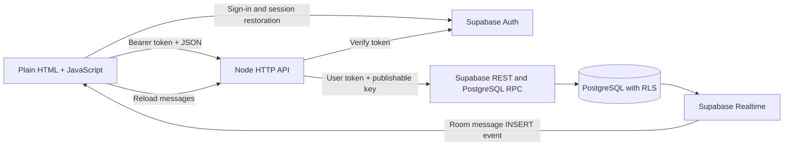
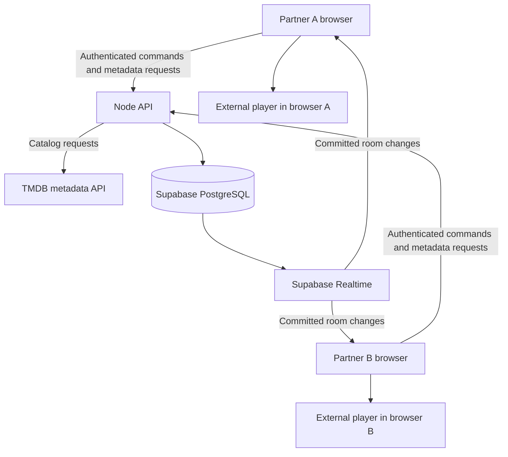

# Multiplay — watch-together-anything

A watch-together app for couples. Each unique pair of accounts shares **one room with at most two members**. An account may have separate rooms with different partners. Inviting the same partner again returns the existing room; renaming keeps its list, chat and progress. User IDs are never hard-coded.

This is a working development backend with an HTML/JavaScript frontend. Authentication, profiles, room invitations, saved/live chat, TMDB discovery, shared lists, per-title/episode progress, resume, and both-partner watched confirmation are implemented. Movies and episodes open in VidRift (primary), VidSpark, VidBolt, CineSrc, or CinemaOS. Native controls update the shared room and both-ready buffering holds remain enabled. Phase 2 still requires applying its migration and live two-account/network acceptance testing.

Read first: [Why TMDB?](#why-tmdb-is-part-of-this-project) · [Complete target design](#complete-target-design--planned-features) · [Local setup](#setup-from-a-fresh-clone) · [Implemented APIs](#implemented-http-api) · [Remaining work](#remaining-work-and-suggested-order)

## Frontend redesign — Phase 1

The frontend now has Home, Discover, Our List, Watch Room and Profile views. Normal visits use the same-origin backend and show a simplified sign-in screen. Existing Supabase session restoration is retained. Home shows the room's current title and up to four saved titles; it does not claim to implement per-title Continue Watching history. Room seats use server-reported names/readiness where available, without presenting membership or readiness as proof of online presence.

The watch view brings the video forward once a title is loaded. Chat docks beside the video on laptops, stacks beneath it on narrow screens, and stays available in expanded/fullscreen viewing. Opening chat or changing views does not recreate the player. Native controls, the both-ready buffering hold, retries, and shared commands retain their existing behavior. Source choices and backup shared controls are inside playback options; technical playback information is inside Connection details. Phase 2 adds the completion panel described below.

Developer settings and the API contract live at `http://127.0.0.1:3000/#developer`. Select Local Demo and Connect there to preview without an account. With Node off, serve `frontend/` with a static server and open `index.html#developer`, or open that local file directly. The browser SDK/fonts/styles still need internet access as before. Explicit demo selection persists across refresh; its sample lists/chat reset on reload. Back to sign-in exits preview and restores same-origin API mode. Development settings do not appear in the normal sign-in flow.

Phase 1 itself needs only a hard refresh. The approved Phase 2 below requires a database migration. Mutual interest and Tonight's shortlist were explicitly removed from scope. Permanent room departure, signup/recovery and optional couple features remain future work. Each next phase needs the owner's approval and an opportunity to omit changes.

## Phase 2 — couples, resume and watched tracking

For an existing installation with schema/playback already applied, run the complete `backend/phase2.sql` in Supabase SQL Editor. For a fresh database, run `schema.sql`, `playback.sql`, then `phase2.sql`. Always reapply Phase 2 last if rerunning the older files, because it upgrades room functions/triggers. Restart Node and hard-refresh both clients. This repository change does not apply SQL to your hosted Supabase project automatically.

- **One room per couple:** `watch_couples` enforces a sorted, unique pair of user IDs. A transactionally enforced membership trigger prevents the same pair from forming a second room, including direct RPC requests. Repeated joins are safe even when a room is full. A different partner can form a different couple. A candidate room stays available for a different partner when its invitation resolves to an existing couple's room.
- **Existing duplicate rooms:** the oldest room is canonical. Lists are combined, messages retain IDs/bodies and move to the canonical room, and old room records/list rows remain archived through `canonical_room_id`. Colliding message retry IDs are regenerated so both messages survive. Existing playback snapshots seed progress. Old invitation codes resolve to the canonical room; room list aliases preserve remembered selections. No room or chat history is deleted.
- **Rename and invitations:** either member can rename their existing room. Room settings provide a copyable `#invite=CODE` link; the sign-in flow remembers and accepts it after authentication. Codes or complete links can be pasted into Join. Invalid/full invitations remain actionable and can be dismissed. Links use the current app address; a localhost link requires the partner's own local server. Remote use requires a deployed, reachable app address. Expiry/rotation and production deployment are separate work.
- **Shared progress:** `watch_room_progress` stores each movie or exact TV season/episode. Positions come from the gated authoritative room clock, never arbitrary browser clock reports. Commands/title changes checkpoint immediately; progress polling checkpoints at most once per 15 seconds while otherwise playing. The readiness gate freezes expired sessions before saving. Abrupt disconnect recovery therefore resumes from the room's valid saved/frozen state rather than advancing through an offline interval. Selecting a previous title/episode restores its position paused; current-title Continue joins without creating another session. Playback still waits for both members.
- **Shared list/history:** selecting a title automatically saves it to the room's list using server-fetched TMDB metadata. Our List has All/Planned/Watching/Watched filters. Movies become Watched only after both confirmations. TV cards show watched-episode counts and stay Watching; episode history identifies finished episodes separately. A TV card can appear in the Watched filter because it contains watched episodes, without declaring the series finished. Continue Watching Together skips completed episodes/movies.
- **Finished together:** each member confirms separately for the current session and completion epoch. Repeated confirmation by one account counts once; both members must exist. The second confirmation marks the movie/episode complete and pauses playback in one transaction. Pending unfinished confirmations are invalidated when a new session starts for that media. Undo explicitly clears both confirmations and increments the epoch, so delayed old confirmation requests cannot finish it again. Old completed history persists until explicitly undone. Progress/confirmation writes are RPC-only, member-authorized, and serialized under the room lock.
- **Delivery:** room-filtered progress events refresh the UI, with an eight-second automatic check alongside chat for missed events. Room names/member details refresh separately. Generation checks reject delayed history from another room/account. Local Demo previews progress and has an explicitly labelled simulated-partner confirmation button; the real API always derives the confirmer from authentication and ignores client-supplied partner identities.

Implemented endpoints: `GET /api/rooms` includes canonical IDs and aliases; `GET /api/rooms/{id}/details`; `PATCH /api/rooms/{id}` with `{name}`; `GET /api/rooms/{id}/progress`; and `POST /api/rooms/{id}/completion` with `{sessionId,epoch,confirmed}`. A stale session/epoch returns 409. Progress entries include `{media,positionMs,updatedAt,completedAt,completionEpoch,confirmedBy}`. Undo sends `confirmed:false`; old `/api/sessions/.../complete` routes do not exist. List GET statuses are computed from saved progress; post-mutation clients should reload the list.

Validation covers real PostgreSQL functions/RLS through PGlite, duplicate-room preservation, per-pair uniqueness, different partners, safe full-room rejoining, rename authorization, independent title/episode resume, both-user completion, stale undo/session handling, readiness-expiry clock freezes, authenticated HTTP handler validation, invitation parsing, and stale frontend history. Browser Local Demo covers the completion lifecycle, list filtering and per-episode history. Live Supabase migration/publication and two-device acceptance must still be checked with your accounts.

## Requirements and implementation status

VidRift is the default player. Reload and fullscreen are icon controls inside the player toolbar, with keyboard focus, accessible labels, and tooltips. Chat updates live, checks for missed messages every eight seconds, and retries failed loads automatically. The retired VidLink provider and fallback button are removed. Reapply `backend/playback.sql` to update the default and move any old VidLink sessions to VidRift, paused at their saved position. Other existing provider selections are preserved.

Chat includes playback notices: the live notice names unready room members (for example, "Waiting for Tridib to be ready…"). Accepted Play/Pause commands add saved notices using the verified actor's profile name, including native player controls. Play requested during loading says playback will start when both are ready. Automatic buffering holds/resumes do not create actor notices, and command retries do not duplicate them. These notices use the existing chat subscription/unread badges. Local demo previews Play/Pause notices through its shared buttons.

For this upgrade, rerun the complete `backend/playback.sql` in Supabase SQL Editor, restart Node, and refresh both browsers. It adds the chat message `kind` column and named readiness data while preserving existing messages and rooms. Clients may send ordinary text messages; the playback RPC alone authors playback notices. Names default to "Partner" until a display name is saved.

The intended experience lets both partners control playback, maintain a shared movie/show list, chat, and move titles to Watched after finishing together. Episode progress must be distinguished from completing a series. Development aims to use free services; production cost and capacity are not established.

| Feature | Status | Notes |
| --- | --- | --- |
| HTML frontend | In progress | Dark theme, icon navigation, and floating chat; no build step yet. |
| Local demo | Done | In-memory catalog, list, room state, and chat for frontend work with Node off; resets on reload. |
| Email/password sign-in | Done | Supabase session restoration/refresh; Node verifies access tokens. |
| Editable profiles | Done | Display name and avatar persist in PostgreSQL. |
| Room creation/invitation | Done | Database functions create membership; trigger enforces two members per room. |
| Joined-room list/selection | Done | Member-only list; connection and selection preferences use local storage. |
| Saved text chat | Done | Latest 100 messages; verified sender; duplicate client message IDs ignored on retry. |
| Live chat | Done | Room-filtered Supabase Postgres Changes events trigger message reloads; automatic checks every eight seconds recover missed updates. |
| TMDB browsing/search | Steps 1–3 implemented | Browsing/search, posters, pagination, title details, season/episode selection, and loading/error states. Playback remains separate work. |
| Shared movie/show list | Implemented; live database validation pending | Room-scoped add/read/remove, duplicate protection, canonical TMDB snapshots, and member-only live updates. |
| Shared playback | Implemented; live validation pending | Persisted sessions, member commands, safe retries, Realtime, polling, native controls, and drift correction on five controllable providers. |
| Embedded playback | Implemented; two-account acceptance pending | VidSpark/VidRift/VidBolt passed isolated paired stream tests. All providers use the both-ready gate. |
| Shared title/episode progress | Implemented; migration/live acceptance pending | Room-scoped history, authoritative checkpoints and Continue Watching Together. |
| One room per couple and rename | Implemented; migration/live acceptance pending | Sorted account pair uniqueness, repeat-invite reuse and archive migration. |
| Watched completion | Implemented; migration/live acceptance pending | Both-member confirmation, episode tracking, stale-request protection and undo. |
| Public signup/recovery | Pending | Only sign-in UI exists; create test accounts in Supabase Dashboard. Check project signup settings separately. |
| Production deployment | Pending | Node listens only on 127.0.0.1:3000. |

## System design



- **Frontend:** frontend/index.html with inline JavaScript and the Supabase browser SDK from jsDelivr. Local demo stays available for independent frontend work.
- **Backend:** Node native http, fetch, fs, and path; CommonJS modules. The installed dependency is @supabase/server for token verification. No framework or ORM.
- **Database:** Supabase PostgreSQL. Node forwards the user's token to REST/RPC calls, so Row Level Security (RLS) applies. This implementation does not use a service-role/secret key.
- **Realtime:** Browser subscriptions listen for inserts in the selected room. Events cause an authenticated API reload; PostgreSQL retains the messages. RLS controls readable records.
- **Catalog:** Node proxies TMDB popular movie/TV lists, search, title details, and TV seasons/episodes with a server-only token. Browse renders posters, pagination, and a details panel.
- **Playback:** PostgreSQL stores room state; frontend/shared-playback.js applies updates through frontend/player.js. Use the expand icon in the player toolbar to expand the video and keep the chat icon at the upper right. The message panel opens beneath the icon without reloading the video. Both chat icons show an unread badge for new incoming texts while the panel is closed; opening chat clears it. Existing history, outgoing messages, and duplicate reloads do not increase the count. Counts reset on room changes, reconnect, and sign-out and are not persisted across page reloads. Browsers without Fullscreen API support use an expanded page view. Embedded providers cannot enter their own separate fullscreen view, which would hide the app's chat.

### Main flows

1. **Sign in:** Supabase Auth supplies a session. /api/me verifies it and reads or creates the user's profile. Requests retrieve the current session rather than retaining an expired token.
2. **Create room:** Node calls create_watch_room. One database transaction creates the room, generates a random 12-character invite code, and adds the creator as a member.
3. **Join room:** join_watch_room finds the code and locks the room row before inserting membership. A trigger uses a transaction lock and count to enforce the two-member limit.
4. **Send chat:** Node checks membership, derives sender ID from verified claims, reads their name, validates text, and inserts it. The combination of room ID, sender ID, and client message ID prevents duplicate inserts on retry.
5. **Receive chat:** A Realtime event triggers an API fetch. Room changes/sign-out remove the old subscription. Generation/request checks prevent stale responses from replacing another room's chat.

## Why TMDB is part of this project

Think of the app as three connected pieces: **a catalog to choose something, a player to watch it, and a private room to experience it together**.

| Responsibility | Service/component | Example |
| --- | --- | --- |
| Find and describe a title | TMDB, through our Node API | Search for a title, read its details, and choose a TV season/episode |
| Save the couple's choices and activity | Supabase PostgreSQL | Shared list, chat, membership, playback session, completion confirmations |
| Show the video | VidRift primary; VidSpark/VidBolt/CineSrc/CinemaOS alternatives | Each browser loads its own stream |
| Keep both partners coordinated | Backend, database, Realtime, and player adapter | Commit room state and apply it to CinemaOS players |

### What TMDB gives the frontend

TMDB supplies catalog metadata and images. The integration uses popular lists and search for movie/show names, poster references, summaries, dates, and identifiers. Details include genres, status, movie runtime, and TV seasons/episodes. Browse uses real results in Backend API mode and keeps the sample catalog in Local demo. See [TMDB's introduction](https://developer.themoviedb.org/docs/getting-started) and [search-to-details workflow](https://developer.themoviedb.org/docs/search-and-query-for-details).

A shared-list item should refer to a title using `(mediaType, tmdbId)`, such as `('movie', 155)`, instead of treating a typed title as its identity. Movie and TV IDs are separate namespaces, so store the type too. For an episode, also store season and episode numbers. This avoids ambiguity between remakes, translations, and titles that share a name.

TMDB is our chosen catalog source, not a requirement of Node, Supabase, or synchronized playback. A minimal manually entered video-link app could work without it. We want browsing, search, posters, TV episode selection, and consistent identities across saved lists, so a catalog service avoids building and maintaining those records ourselves. Another catalog source could replace it behind our backend's normalized API.

### What TMDB does not give us

TMDB is not our movie streaming server. Its catalog does not make a full movie playable, establish streaming rights, guarantee an external provider has a matching video, or synchronize two players. Video-related metadata and trailers must not be mistaken for full-film hosting. The goal of broad movie coverage means searching the available catalog; we cannot promise literally every title or playable availability for every result.

VidRift is the primary embed provider for new sessions. VidSpark, VidBolt, CineSrc, and CinemaOS remain selectable. In Backend API mode, Watch creates a shared room session. Original player controls and shared buttons send authenticated room commands. Metadata discovery and actual stream availability are separate. See the playback acceptance check below.

### TMDB request flow

1. Browser requests `/api/search?type=movie&q=...&page=1`, or `/api/catalog?type=tv&page=1` for browsing.
2. Node validates parameters and calls TMDB with `TMDB_READ_ACCESS_TOKEN` from its environment. The token is never sent to browser code.
3. Node normalizes TMDB's movie/TV response fields to our title shape: ID, type, title, year, overview, poster reference, and pagination information.
4. The frontend renders title cards, posters, page navigation, and details. Adding a title now saves its identity and a small metadata snapshot in the selected room's list; the catalog is not copied into Supabase.
5. Watch saves the title/episode to the selected room and opens CineSrc for new sessions after the updated playback migration. The partner clicks Join playback. Provider changes apply to both joined clients.

Step 1 implements catalog/search, parameter validation, a 10-second upstream timeout, safe error messages, upstream rate-limit handling, and a 60-second in-memory metadata cache capped at 100 entries. Authentication runs before cache reads. No arbitrary upstream URLs are accepted.

Step 2 adds poster rendering and Previous/Next navigation to Browse. Images load lazily from TMDB's image CDN at `w185`, following [TMDB's image URL format](https://developer.themoviedb.org/docs/image-basics); missing/failed images show “Poster unavailable.” Search submission starts at page 1. Navigation keeps the last submitted type/query even if the inputs have been edited. Buttons are disabled while loading and at page boundaries. Loading, empty, and error states appear beside Browse. Failed requests keep previous results; older responses cannot replace a newer search or results after reconnect/sign-out. Local demo stays available with its existing single-page samples. The required TMDB notice is displayed; an approved TMDB logo is still needed before publishing.

To check step 2, hard-refresh `http://127.0.0.1:3000/`, sign in, choose Backend API, leave Backend origin blank, and Connect. Submit an empty Movie search to browse popular titles, use Next/Previous, then search for a movie or TV show and confirm the page resets to 1. Verify posters, page boundaries, and no-result searches. Switch to Local demo and confirm sample browsing still works. Add uses the shared list; Watch creates a shared session in Backend API mode.

Step 3 adds a Details button to every title card. The panel shows the overview, genres, release year, status, and movie runtime. TV titles load seasons from TMDB, including specials (season 0); selecting a season fetches its episodes. Episode selection shows the name, summary, air date, and runtime when available. Metadata can include future episodes and does not guarantee playable availability. Opening another title, closing details, reconnecting, or signing out invalidates pending responses. Failed season requests have a Retry button. Episode selection belongs to the opened show; Watch together on another show opens that show's details first. Local demo uses explicitly labelled sample seasons/episodes.

To check step 3, restart Node and hard-refresh the page. Connect in Backend API mode, search for a movie, and open Details. Then search TV for Breaking Bad, open Details, switch seasons, and select an episode. Confirm the episode text changes. Try switching titles/seasons while requests load, closing details, and Local demo. Detail selection stays local until Watch is clicked. The catalog needs no migration; shared playback requires backend/playback.sql.

TMDB's developer API is free for noncommercial use with attribution; commercial use needs separate arrangements. Before publishing, include an approved TMDB logo and the required notice: “This product uses the TMDB API but is not endorsed or certified by TMDB.” Review current terms if the app starts generating revenue. [TMDB FAQ and attribution requirements](https://developer.themoviedb.org/docs/faq)

## Complete target design — planned features

This section explains the intended end-to-end system. The implementation table above remains the source of truth for what currently works. Details introduced here are proposals for the remaining work, not promises that corresponding tables or routes already exist.

### Technology choices and responsibilities

| Layer | Choice | Why it fits |
| --- | --- | --- |
| Frontend | HTML/JavaScript with a dark theme, icon navigation, and floating chat | Uses the existing API endpoints without a build pipeline. |
| HTTP API | Node.js native HTTP server | Small backend, already running; validates requests and coordinates authenticated database/provider calls. |
| Identity | Supabase Auth | Account/session lifecycle; each person has their own identity. |
| Durable state | Supabase PostgreSQL with RLS | Transactions, room membership, saved lists, messages, progress, and authoritative playback snapshots. |
| Change delivery | Supabase Realtime | Notify the selected room's clients about committed state changes. It does not replace persistent state. |
| Catalog | TMDB through Node | Browsing, search, posters, title details, season/episode selection, and consistent title IDs. |
| Playback | VidRift/VidSpark/VidBolt/CineSrc/CinemaOS adapters | Each browser plays its own stream; the backend coordinates controls |
| Source collaboration | GitHub/GitHub Desktop | Share code and documentation. Git synchronization does not migrate a Supabase database or copy local environment files. |

No Redis or Kafka is needed for the initial two-person-per-room design. Reassess only when measured requirements justify more infrastructure. Specific hosting providers and production resource sizes have not been chosen.



### Accounts, invitations, membership, and presence

People can sign into the app with valid accounts. Room access additionally requires membership: being signed in must not grant access to every couple's chat, list, or playback session. Room creation inserts the creator's membership; an invited partner joins the same room. Each room is independent of other couples' rooms.

The capacity rule means two distinct member accounts, not two WebSocket connections. A partner opening a second tab must not consume a third membership slot. Joining an already joined room should be idempotent; the known trigger/ON CONFLICT issue below needs correcting. Invite lookup, membership insertion, and capacity enforcement must remain transactional.

Membership and presence are different. Membership is the durable permission to access the couple's room. Presence means currently watching/connected/ready and expires when a connection disappears. Leaving a watch session should not silently delete room membership, shared lists, or chat. Permanent room departure, deletion, invite rotation, and account recovery need explicit product flows.

For a public couples app, add frontend signup, email confirmation/recovery, invitation abuse controls, and production URLs. The existing manual account-creation setup is a development shortcut. Do not add a global hard-coded allowlist of our two personal user IDs.

### Shared list and TV progress

Use room-scoped data, rather than a global list or the current null groupId placeholder. A proposed list item has room ID, media type, TMDB ID, added-by user, timestamps, and a status such as Planned/Watching/Watched. Uniqueness on room + media type + TMDB ID prevents duplicates. Store small metadata snapshots only where useful; TMDB remains the catalog source.

Both partners can add/remove items. Every mutation checks room membership, commits to PostgreSQL, and notifies the room so both views update. Reconnecting fetches the saved list again. Private lists from different rooms must never mix.

For a TV show, store per-episode progress separately using show ID, season, and episode. Completing one episode does not complete the series. Agree how to handle new seasons and newly released episodes before declaring a whole show Watched.

### Shared playback state and command flow

Both partners have equal play/pause/seek/provider control. The backend/database is the authority for room state. Realtime messages notify clients of accepted state; clients must not treat an unauthenticated browser message as authority.

The implemented playback snapshot contains room ID, session ID, media identity, season/episode if applicable, provider, playing/paused status, position at an anchor time, server anchor timestamp, and an increasing revision. Presence/readiness and connection state should be modeled separately from the saved list and membership.

1. A partner chooses a title/episode, uses a native player control, or presses a shared button.
2. Browser sends a command ID, session ID, expected revision where appropriate, action, and validated arguments.
3. Backend authenticates the sender, checks room membership/current session, validates the action, and applies it in a database transaction.
4. A unique command ID makes retries safe. Locking or revision checks serialize simultaneous commands; stale commands are rejected and return the current state rather than changing a newer session.
5. Committed state gets a new revision and server timestamp. Realtime notifies both clients; each applies newer revisions and ignores older snapshots.
6. A newly connected client fetches current state instead of expecting to receive every historical event.

For playing media, compute the intended position as anchor position plus elapsed server time. For paused media, keep the anchor position. For example, a playing snapshot anchored at 100 seconds five seconds ago implies approximately 105 seconds now. Correct for client/server clock offset and network delay rather than trusting each browser's wall clock equally.

A provider adapter should expose load, ready, play, pause, seek, position/status reporting, error, and ended capabilities. Apply state after the player is ready, handle browser autoplay restrictions with an explicit user action, and prevent remote changes from being echoed back as new commands. Measure drift and tune correction thresholds during two-device testing; no synchronization latency guarantee exists yet.

The implemented readiness policy pauses the room until both partners are prepared at the same fixed position; buffering holds preserve play intent, while manual Pause cancels it. Presence loss should show disconnected/reconnecting and preserve the session. Reconnects load the latest snapshot, not an old locally cached position.

### Critical external-player limitation

A cross-origin iframe cannot be controlled simply by inspecting its internal video element. postMessage communication only helps if the embedded player supports the commands/events we send. Outgoing messages need an exact target origin; incoming messages must validate origin, source window, and payload. [Browser cross-origin communication](https://developer.mozilla.org/en-US/docs/Web/API/Window/postMessage)

Before claiming watch synchronization works, verify both the primary and fallback provider on real browsers for play, pause, seek, readiness, timing feedback, and native-control events. If a provider has no supported control API, a synchronized state database alone cannot control its video. Disable unsupported shared controls and explain the limitation; do not label that playback as synchronized.

Provider switching should pause the shared session, preserve title/episode and intended position, load the replacement on both sides, wait for readiness, and then resume by an agreed action. Confirm providers use compatible media/episode identifiers and timelines. Playback availability and external provider behavior remain dependencies outside our application's control.

### Finished together and Watched

The selected requirement is finishing together, not “one person clicked play” or “one player emitted ended.” Store completion confirmations scoped to the exact playback session, media version, member user ID, and episode if applicable. Repeated confirmation from one user must not count as two people.

When both current room members confirm the same session, commit watched/progress records and the list transition in one transaction. Show a waiting-for-partner state after the first confirmation. An ended event may prompt confirmation but should not unconditionally mark a title Watched. Changing title/episode or creating a new session must not reuse confirmations from an earlier one. Undo should make an explicit correction that both clients see.

### Text communication

Saved text chat is already implemented. PostgreSQL stores messages, the API checks membership and sender identity, and Realtime prompts the current room to reload. Future additions include older-message pagination, visible delivery/reconnect state, and message retention/deletion choices.

### Proposed remaining data and API boundaries

These are design proposals, not installed schema or implemented routes. Keep authoritative operations transactional and apply RLS on every room-owned table.

| Proposed data | Responsibility |
| --- | --- |
| Room list items | Planned/Watching/Watched title identity and room ownership |
| Episode progress | Watched episodes and progress independently of whole-show status |
| Playback sessions / current state | Shared title, episode, provider, position anchor, status and revision |
| Applied commands | Retry deduplication and ordering of accepted playback mutations |
| Session completion confirmations | One confirmation per member for the current session/media |
| Playback readiness/presence | Short-lived room readiness and connected participants |

The implemented catalog endpoints are GET /api/catalog, GET /api/search, GET /api/titles/{movie|tv}/{tmdbId}, and GET /api/titles/tv/{tmdbId}/seasons/{seasonNumber}. New shared-list APIs should be room-scoped. Playback needs snapshot, media selection, control, and presence endpoints; completion needs confirm/undo operations. Define exact response shapes and update the starter's contract before implementing each feature; the old group-based mock routes are not a finalized backend contract.

### Nonfunctional requirements and tradeoffs

| Area | Target/design rule |
| --- | --- |
| Isolation | Every couple's rooms, lists, chat, progress, and playback are accessible only to their members. |
| Consistency | Enforce capacity, command ordering, and shared completion in transactions. Use deduplication IDs and revisions for retries/reconnects. |
| Durability | Store user-owned history and current snapshots in PostgreSQL; do not rely on a single Node process's memory or WebSocket events. |
| Responsiveness | Deliver chat/control changes promptly; measure two-device latency and playback drift before setting numerical targets. |
| Recovery | Refresh/reconnect restores the last committed state. Show meaningful offline/provider errors and preserve user intent safely. |
| Security | Verify tokens, enforce RLS/membership, validate inputs, use HTTPS/WSS in deployment, keep server tokens out of the browser, and add rate limits before public release. |
| Privacy | Treat room messages and lists as private data. Stored chat is not end-to-end encrypted; do not claim it is. Plan retention, deletion, and backup access. |
| Compatibility | Test mobile/desktop browsers, autoplay restrictions, iframe capabilities, and network conditions. |
| Maintainability | Keep provider adapters replaceable, document APIs, add migrations/tests, and preserve Local demo for independent frontend development. |
| Cost | Bound requests, metadata caching, chat history, and live connections. Track database, Realtime, and hosting usage. Free-tier availability is not an unlimited-service guarantee. |

There are no production availability, user-count, or latency commitments yet. Two participants per room is a product limit; it is not a claim that total application traffic is limited to two people. Scale estimates need an expected number of simultaneous rooms and measured provider/service quotas.

### Deployment and developer collaboration

For remote couples, serve the app over HTTPS and deploy the API to a reachable host; the current loopback-only server is local development. Use same-origin frontend/API routing where possible. If splitting them, implement an explicit CORS allowlist and configure auth URLs/session handling. Set production environment variables securely, apply reviewed migrations, and verify Realtime publication/RLS after deployment.

GitHub Desktop synchronizes source files. It does not transfer .env credentials, install npm dependencies, apply database changes, or make a local server accessible to a partner. Each checkout follows the setup instructions below. Avoid running both old and new checkouts on port 3000 and then editing a different copy of the source.

The frontend developer can design in Local demo without the API running. Backend work should expose stable, documented JSON contracts. The frontend should display clear states for loading, no room, waiting for partner, disconnected, and player unavailable. Agree on completed feature acceptance using two separate authenticated browser profiles before adding more features.

## Repository map

```text
frontend/index.html        HTML UI, demo/mock backend, auth and Realtime client
frontend/player.js         Provider URLs, iframe lifecycle, commands and validated events
frontend/shared-playback.js Room state, subscriptions, retries and drift correction
backend/playback.js        Authenticated state/media/command API
backend/playback.sql       Playback tables, transactional RPC, RLS and Realtime
backend/phase2.sql         Couple uniqueness, archive migration, resume and watched RPCs
backend/couple.js          Authenticated room details, rename, progress and completion API
backend/phase2-db.test.js   PostgreSQL couple/progress/completion and upgrade checks
backend/couple-api.test.js  API authorization and request validation
backend/phase2-frontend.test.js Invitation parsing and history isolation
backend/playback-db.test.js PostgreSQL permissions, revision and retry checks
backend/shared-playback.test.js Simulated two-client synchronization checks
backend/server.js          HTTP server, root page, profile and room APIs
backend/chat.js            Chat API, membership checks and validation
backend/watchlist.js       Room-scoped list API and TMDB snapshots
backend/watchlist.test.js  Mocked API/frontend regression checks
backend/tmdb.js            Authenticated TMDB catalog/search and metadata cache
backend/schema.sql         Tables, RLS, RPCs, capacity trigger, Realtime publication
backend/package.json       Backend dependencies
backend/package-lock.json  Locked dependency versions
.gitignore                 Excludes .env files and node_modules
```

## Setup from a fresh clone

Use Node.js 22 (development used 22.14.0), npm, and a Supabase project. Run commands from the repository root:

```powershell
npm ci --prefix backend
```

Create a root .env file locally:

```dotenv
SUPABASE_URL=https://YOUR_PROJECT.supabase.co
SUPABASE_PUBLISHABLE_KEY=YOUR_PUBLISHABLE_KEY
TMDB_READ_ACCESS_TOKEN=YOUR_TMDB_READ_ACCESS_TOKEN
```

The browser also has SUPABASE_URL and SUPABASE_PUBLISHABLE_KEY constants in frontend/index.html. If using a different Supabase project, update both those constants and .env. A publishable key may be used in browser code. Never put a Supabase secret/service-role key or TMDB token in HTML or commit .env.

Use `.env.example` as the configuration template. For TMDB, copy the **API Read Access Token** from your TMDB account's Settings → API page, not the shorter API key. Node sends it as a Bearer token ([official authentication documentation](https://developer.themoviedb.org/docs/authentication-application)). Restart Node after setting it. No database changes are needed for catalog/search.

A fresh clone does not include the previous checkout's .env or installed dependencies. Keep local configuration in the checkout you actually run.

1. Run `backend/schema.sql`, then `backend/playback.sql`, then `backend/phase2.sql`, in Supabase SQL Editor. Existing installations that already have the first two need the new Phase 2 file. Apply Phase 2 last on later upgrades as well.
2. Create test email/password accounts under Supabase Authentication → Users. They must be able to sign in under the project's email-confirmation settings.
3. Start Node from the repository root:

   ```powershell
   npm --prefix backend run dev
   ```

4. Open [http://127.0.0.1:3000/](http://127.0.0.1:3000/) and sign in. Successful sign-in verifies the account, switches to **Backend API**, and loads rooms and the catalog automatically. Local demo remains available from the connection selector. The Node server needs outbound network access to Supabase to verify tokens and load database records.
5. Create a room. In a second browser/profile, sign into a second account and join by code.

The dev command uses Node watch mode to reload imported backend files when edited. Restart it after .env edits. Use `npm --prefix backend start` for a run without automatic reload. Hard-refresh after HTML changes; Node reads the file for each page request. Keep a consistent origin: localhost and 127.0.0.1 have separate browser session/preference storage.

The schema supports reapplication during development through IF NOT EXISTS and policy/function replacement. It also contains legacy upgrades dropping the old singleton room flag and obsolete unique-user constraint. Review before applying to populated environments. There is no versioned migration runner.

### Local demo and Backend API

- **Local demo:** core mock workflows use in-memory samples without Node. The page still loads the Supabase SDK from a CDN; real sign-in checks require the backend.
- **Backend API:** real profiles, rooms, chat, TMDB, shared lists, and playback sessions. Connect saves mode/origin preferences.
- The supported setup serves HTML and API from the same Node origin. Despite the Backend origin input, CORS/OPTIONS support is not implemented. The sign-in check also assumes localhost/127.0.0.1 on port 3000.
- 127.0.0.1 refers to the browser's machine. A partner on another computer cannot reach this local server without deployment or deliberate network and URL changes.

## Implemented HTTP API

Except for /, /player.js, /shared-playback.js, and /api/health, send:

```http
Authorization: Bearer <Supabase user access token>
apikey: <Supabase publishable key>
Content-Type: application/json
```

Content-Type is needed for JSON bodies. Errors use an object with an error string. Chat also explicitly checks room membership.

| Method | Path | Request | Successful response |
| --- | --- | --- | --- |
| GET | / | — | HTML starter |
| GET | /player.js | — (public static asset) | Browser player integration JavaScript |
| GET | /api/health | — | {status:"ok"} |
| GET | /api/catalog?type=movie&page=1 | type: movie or tv | {items:[{tmdbId,mediaType,title,year,overview,posterPath}],page,hasMore} |
| GET | /api/search?type=tv&q=Breaking%20Bad&page=1 | type: movie or tv; q: trimmed 1–200 characters | Same shape as catalog |
| GET | /api/titles/{movie\|tv}/{tmdbId} | Positive 32-bit TMDB ID | {title:{...catalogTitle,genres:[string],runtimeMinutes,status,seasons:[{seasonNumber,name,episodeCount,airDate}]}} |
| GET | /api/titles/tv/{tmdbId}/seasons/{seasonNumber} | Season 0–9999 (0 is specials) | {tmdbId,mediaType:"tv",seasonNumber,name,episodes:[{episodeNumber,name,overview,airDate,runtimeMinutes}]} |
| GET | /api/me | — | {userId,profile:{displayName,avatarKey},groupId:null,roomId:null} |
| PATCH | /api/me/profile | {displayName,avatarKey} | {profile:{displayName,avatarKey}} |
| GET | /api/rooms | — | {items:[{roomId,name,inviteCode,aliases}]} |
| POST | /api/rooms | {name}; defaults if omitted | 201 {roomId,name,inviteCode,createdBy} |
| POST | /api/rooms/join | {inviteCode} | {roomId,name,reused,joinedBy} |
| GET | /api/rooms/{roomId}/details | — | {roomId,name,inviteCode,members:[{userId,displayName,avatarKey}]} |
| PATCH | /api/rooms/{roomId} | {name} | {roomId,name} |
| GET | /api/rooms/{roomId}/progress | — | {items:[{media,positionMs,updatedAt,completedAt,completionEpoch,confirmedBy}]} |
| POST | /api/rooms/{roomId}/completion | {sessionId,epoch,confirmed} | Updated progress; 409 for stale session/epoch |
| GET | /api/rooms/{roomId}/messages | — | {items:[{id,senderId,senderName,body,sentAt}]} |
| POST | /api/rooms/{roomId}/messages | {clientMessageId,body} | 201 {sent:true} |
| GET | /api/rooms/{roomId}/list | — | {items:[{id,status,watchedEpisodes,title:{tmdbId,mediaType,title,year,overview,posterPath}}]}; status: planned/watching/watched |
| POST | /api/rooms/{roomId}/list | {mediaType,tmdbId} | 201 {item} for new title; 200 for existing/restored title |
| DELETE | /api/rooms/{roomId}/list/{itemId} | — | 204, or 404 if item does not belong to this room |

Playback routes (all require room membership):

| Method | Path | Request / result |
| --- | --- | --- |
| GET | `/shared-playback.js` | Public browser synchronization script; no authentication required |
| GET | `/api/rooms/{roomId}/state` | Current snapshot; empty rooms have revision 0 and null media/session |
| POST | `/api/rooms/{roomId}/media` | `{commandId,expectedRevision,mediaType,tmdbId,season?,episode?}`; creates session using canonical TMDB metadata |
| POST | `/api/rooms/{roomId}/commands` | `{commandId,expectedRevision,sessionId,action,targetPositionMs?,provider?}`; action is play/pause/seek/provider |

Snapshots contain `{roomId,sessionId,media,provider,status,positionMs,anchorAt,revision,serverTime}`. Command IDs are UUIDs; seek positions are integer milliseconds from 0 to 604800000. Missing migration returns 503 with setup instructions; stale commands return 409 with `{error,state}`. Provider changes pause the session.

Profile names are trimmed and limited to 1–40 characters. Avatar keys: moon, sun, star, heart. Messages are trimmed and limited to 1–2000 characters; client message IDs must be UUIDs. Chat reads return the latest 100 messages in chronological order, without older-message pagination.

Catalog uses TMDB's popular lists; search uses its movie/TV search endpoints. Both require sign-in but no room membership. `page` defaults to 1 and accepts integers from 1 to 500. Results use English (`en-US`); `year` is a string (empty when unknown), and `posterPath` is a TMDB image reference or null. Search excludes adult titles. Errors: 400 invalid parameters, 401 invalid session, 503 missing TMDB configuration, 429 upstream rate limit, 502 upstream failure, 504 upstream timeout. TMDB response bodies and credentials are never returned to the browser.

Details and season routes use the same authentication, bounded cache, timeout, and upstream error handling. Missing titles/seasons return 404. Details include genre names, movie runtime in minutes or null, and an empty seasons array for movies. Episodes include nullable airDate/runtimeMinutes. All endpoints return normalized metadata rather than raw upstream response bodies. Step 3 syntax and mocked backend/frontend checks passed, including specials, ID validation, auth/cache, missing/malformed upstream data, episode display, and stale responses after closing details. Live browser validation of the new panel remains to be completed.

Contract caveats:

- /api/me still returns null groupId/roomId placeholders. Choose a room using /api/rooms.
- Join returns `joinedBy` for the requester; room creation returns `createdBy`. Neither response grants additional ownership privileges.
- Legacy group-list APIs, general server presence, and session-completion APIs are not implemented. Join/Leave playback now report/clear a readiness lease; room membership is unchanged.

## Database model and access

| Object | Purpose |
| --- | --- |
| auth.users | Supabase-managed identities |
| profiles | One profile per user; users read/insert/update their own row |
| watch_rooms | Room ID, name, creator, invite code, creation time; members can read |
| watch_room_members | Room/user membership and join time; members can read membership in their room |
| watch_room_messages | Text, sender ID/name snapshot, client message ID, room ID, timestamp; member-only reads and self-sender member inserts |
| watch_playback_readiness | Short-lived, per-client readiness for the current session/provider/ready epoch; no direct client table access |
| watch_room_list_items | Unique room/media-type/TMDB-ID title snapshot; removed_at hides removed titles and supports live UPDATE events. Members may update only removed_at. |
| watch_room_playback | Authoritative session snapshot; member-only SELECT |
| watch_playback_commands | Private command deduplication ledger |
| watch_playback(...) | Member-authorized transactional state/command RPC |
| create_watch_room(text) | Authenticated RPC for room and creator membership |
| join_watch_room(text) | Authenticated RPC to join by code |
| is_room_member(uuid) | Membership helper for RLS |
| enforce_room_capacity() | BEFORE INSERT trigger enforcing two members |

RPC/helper functions use SECURITY DEFINER, an empty search path, and explicit schema references. Creation/join execution is granted to authenticated users. Preserve authentication/membership checks when extending these functions: their owner privileges can bypass ordinary RLS.

Message text is rendered with textContent. It is stored as plain text in Supabase; the app does not implement end-to-end encryption. Names are snapshots, so old messages retain the name used when sent.

### Realtime setup and troubleshooting

The end of schema.sql adds watch_room_messages to supabase_realtime without resetting other published tables. Verify using:

```sql
select pubname, schemaname, tablename
from pg_publication_tables
where pubname = 'supabase_realtime'
  and schemaname = 'public'
  and tablename = 'watch_room_messages';
```

A connected channel does not prove database-event delivery. The page displays database-listener status/errors and automatically checks for messages every eight seconds. If polling works but live delivery fails, check this publication, the selected room, and SELECT RLS permissions. Do not disable RLS as a workaround.

## Shared watchlist setup and acceptance check

Run the updated backend/schema.sql in Supabase SQL Editor, then restart Node (or let dev watch mode reload the new modules) and hard-refresh both pages. Connect in Backend API mode and select the same room in two separate accounts. Add a movie and a show from Browse; both should appear in Our list without manual refresh. Add a title twice to confirm only one entry exists. Remove it in either account, then add it again to restore it. Refresh/reconnect to verify persistence. Select a different room to verify isolation.

The backend verifies membership on every list request and fetches canonical title details through the existing TMDB handler before a new insert. It does not trust client-supplied title/overview/creator fields. It stores a small metadata snapshot; no video is saved. Both members may remove any item in their shared list.

Removal is a soft deletion: removed_at is set, active reads exclude that row, and re-adding the same identity restores it. Removed snapshots remain readable to room members at the database level until a future retention/deletion flow is added. This deliberately uses INSERT/UPDATE Realtime events with room filters and RLS, rather than unfiltered Postgres DELETE notifications. The schema adds watch_room_list_items to supabase_realtime. Existing chat and list listeners share the selected room's channel and are removed on room switch/sign-out. Refresh list remains available as a fallback.

All items currently return status planned. Playback and joint completion will introduce Watching/Watched later; there is no client endpoint to mark a title watched in this increment. Active list reads currently rely on the Supabase project's default REST row cap; list pagination is a future task for large lists. The unique identity includes media type so equal movie/TV IDs do not collide. Test results from mocked services do not establish live database RLS or publication correctness.

## Shared playback: VidRift primary

### What happens after Watch

1. Sign in, connect in **Backend API** mode, and select your room. Click **Watch together** on a movie, or select a TV season/episode in Details first.
2. The server checks membership and TMDB metadata, then creates a paused **VidRift** session at zero. Existing sessions keep their selected provider.
3. Your partner clicks **Join playback**. Each browser loads its own stream. Press the original Play button in each iframe if activation is required; this is especially relevant to VidBolt.
4. Either partner can use the player's original **Play, Pause, and seek bar/skip buttons**. These become authenticated room commands. The app's shared buttons remain available as a backup. Play queues intent; the clock waits for both accounts to be ready. Native Pause cancels play intent, and seeking prepares both at a fixed target before resuming if play was requested.
5. Select a provider and click **Switch provider** to change it for both partners. This pauses the room.

Local demo opens a local player without shared backend synchronization. Watch does not mark a title Watched. Join/Leave playback do not change room membership. Close player, room changes, and sign-out clear the local iframe and subscriptions. Choose episodes in the app so both partners keep the same episode.

### Synchronization and native controls

The playback migration stores the session, title/episode, provider, position, server time anchor, revision, play intent, and readiness epoch. Both members may issue commands. The RPC locks the room, checks membership/session/revision, and deduplicates command UUIDs. Conflicts return HTTP 409 with current state. **Retry last playback command** reuses the original body/UUID after a transport failure.

Realtime changes trigger authenticated state reloads, with a three-second polling fallback. Providers with a status getter are polled every two seconds. VidBolt has no confirmed getter and uses pushed events instead. Drift over two seconds triggers a correction seek. Server clock offset uses the request midpoint; old room responses and older revisions are ignored. Connection failures attempt a local pause.

Initialize playback once before testing native seeking; startup position restores are deliberately excluded. The adapter checks the exact iframe window and provider origin, validates finite bounded times, and validates media identity where the provider supplies it. It distinguishes expected Play/Pause/Seek acknowledgements from native actions. Programmatic corrections and buffering pauses do not become new room commands. Native actions are serialized through the same command endpoint as shared buttons; repeated scrubbing samples are debounced/coalesced. Pending actions are protected from correction back to the old anchor. A conflict drops stale queued actions; a transport failure retains the exact command for explicit retry.

Not all providers identify human interaction. VidSpark's seek event is based on a time jump; VidRift and VidBolt do not expose a dedicated seek-completed event in their inspected interfaces. Native seeking therefore uses timestamp discontinuities after the player has first played for initialization, excludes outstanding command seeks and detected stalls, and debounces the result. This is best effort: source changes, player bugs, or changes to the external API can require reloading or the shared buttons. Use normal 1x playback and matching video sources/cuts on both devices.

| Provider | Embed origin | Movie route | TV route | Incoming commands / events |
| --- | --- | --- | --- | --- |
| [VidSpark](https://vidspark.to/) | https://vidspark.to | /movie/{tmdbId} | /tv/{tmdbId}/{season}/{episode} | action: play/pause/seek/getStatus; source: vidspark-player events |
| [VidRift](https://vidrift.net/docs/) — primary | https://embed.vidrift.net | /embed/movie/{tmdbId} | /embed/tv/{tmdbId}/{season}/{episode} | vidrift:play/pause/resume/get-state; state/progress/unpaused/paused events |
| [VidBolt](https://vidbolt.pro/) | https://vidbolt.pro | /movie/{tmdbId} | /tv/{tmdbId}/{season}/{episode} | type: play/pause/seek; ready/durationchange/timeupdate/play/pause events |
| [CineSrc](https://cinesrc.st/docs) | https://cinesrc.st | /embed/movie/{tmdbId} | /embed/tv/{tmdbId}?s={season}&e={episode} | cinesrc:command with command/args; responses and playback events |
| [CinemaOS](https://cinemaos.tech/embed) | https://cinemaos.tech | /player/{tmdbId} | /player/{tmdbId}/{season}/{episode} | command: play/pause/seek/getStatus; PLAYER_EVENT envelope |

VidSpark receives an explicit t parameter to request the room position. A live test still observed a delayed saved-progress restore; initialization jumps are ignored as native intent and corrected to the frozen room anchor. VidRift uses autoplay=0 and receives nextup-info with next:null to suppress automatic advancement. CineSrc disables autoplay/autonext/autoskip/continueprompt. CinemaOS retains its existing autoplay/next settings. VidBolt has no confirmed status getter or autoplay/next query contract; its initial native activation may be necessary. Known episode mismatches reported by CineSrc/VidRift stop readiness until reload. VidSpark/VidBolt do not supply reliable episode identity in their observed messages: use the app to choose episodes.

Iframe load or a provider's ready event alone is insufficient. The adapter requires video metadata/position and subsequent progress or seek acknowledgement for readiness. After 20 seconds without video status, the UI suggests retry or another provider. Iframe errors suggest reloading or choosing another supported provider; cross-origin navigation failures are not always reported. Provider iframes are unsandboxed because some reject a sandbox; the cross-origin DOM boundary remains, but sandbox popup/navigation restrictions do not apply.

### Upgrade and two-account acceptance check

**Required:** run the complete updated backend/playback.sql in Supabase SQL Editor, restart the local server, and hard-refresh both browsers. The migration expands provider constraints, command validation, and the readiness gate, and defaults NEW sessions to VidRift. It is rerunnable and preserves existing rows, selected providers, media, and room membership. This file has been exercised in PGlite; applying it to the hosted Supabase project is a separate setup step. No extra provider key, package, or paid service is needed.

Integrated paired-player tests on **2 November 2026** used the actual player/room-sync adapters and the playback RPC in an isolated PGlite database. Modern Family S1E1 (TMDB 1421) played on VidSpark, VidRift, and VidBolt. Native Play, Pause, and Forward were checked against both actual video elements. VidBolt also demonstrated a fixed-target 1/2-ready hold until the second player was activated. This used two test members and two iframes in one browser, not production Supabase Auth/Realtime or separate computers. Different providers returned different durations/cuts. CinemaOS previously failed on one partner's network; retaining its adapter does not establish availability. A working title today does not guarantee every catalog title or future uptime.

1. Apply the migration, start Node, and use two browser profiles/accounts in the same room.
2. Watch a title and Join playback on both. For an existing session select VidRift and Switch provider. Initialize each native player if needed.
3. Use original Play in one browser; confirm both actual videos advance once both report ready. Use original Pause in the other; confirm both stop.
4. Drag the native seek bar and use Forward/Back in each browser; confirm both reach the same scene. Also check the shared buttons.
5. Slow or interrupt one stream. Verify the clock freezes, the other pauses, and both recover against a fixed timestamp. Pause during a hold and verify recovery does not resume against that choice.
6. Repeat on VidRift/VidBolt, reload/reconnect, change rooms and switch between supported providers. Separate networks, mobile/autoplay behavior, long sessions, and live Supabase delivery still need acceptance testing.

Automated checks cover real PostgreSQL transactions through PGlite, API provider validation, provider envelopes/security, native actions, command echoes, rapid scrubbing, retries, drift, and slow-partner holds. Run npm --prefix backend test from the repository root. These tests do not prove two-device stream access or live Realtime delivery.

## Both-ready playback and buffering holds

**Apply the updated backend/playback.sql, restart/reload Node, and hard-refresh BOTH browsers.** Old sessions and saved media are preserved. Updated clients refuse unguarded playback snapshots from an old migration instead of continuing without readiness checks.

The room now separates playRequested (user intent) from status (whether the shared clock actually runs). Pressing native Play or Play together queues play intent; the actual status stays paused until BOTH member accounts have joined playback and report ready for the current session, provider, and readyEpoch. A room with only one member/ready participant intentionally waits. Manual Pause clears playRequested, so later recovery cannot resume against that choice.

POST /api/rooms/{roomId}/readiness accepts {clientId,sessionId,provider,epoch,ready,joined} and returns the playback snapshot. It uses the authenticated user identity, not a user ID supplied in the body. State snapshots additionally include readyEpoch, playRequested, waitingForReady, and readiness:{readyCount,requiredCount,bothReady}. The UI displays the count and whether it is preparing locally or waiting for the partner. Play/Pause/Seek commands can be requested while loading; the server gate controls actual playback.

The browser reports on readiness changes and renews a lease roughly every two seconds while joined. A lease expires after 15 seconds. Leaving playback, changing room, or signing out releases the current client; interrupted connections expire. Room membership and lists/messages remain intact. Multiple clients do not count as extra people: both distinct member accounts are required, and any fresh joined client reporting unready blocks its account. Leave playback in unused duplicate tabs; background throttling can expire readiness and pause the room conservatively.

Readiness writes and playback commands lock the same room row. Missing, stale, buffering, or unready participants hold the authoritative clock. While a video is loading, its target is a fixed paused position instead of an ever-increasing timestamp. Session changes, provider changes, seeks, and pauses invalidate the old readiness epoch. Old reports cannot unlock a newer target. A buffering hold keeps play intent and resumes when the clients prepare again; a provider change starts paused without resuming automatically.

On a playing-to-held transition, the database freezes position and advances the readiness epoch. On expiry it bounds elapsed time by the earliest member lease deadline, rather than advancing through an entire offline interval. State reads and readiness reports evaluate the gate; no background scheduler is installed. Room revisions change for accepted user commands and automatic hold/resume transitions, not for every healthy heartbeat. Manual commands can still conflict with a concurrent gate transition; the existing conflict/retry UI applies.

The player adapter now distinguishes metadata readiness, observed playback/seek acknowledgement, an outstanding seek, and suspected buffering. It never issues another correction seek while one remains unacknowledged. Initial preparation and recovery seek to a fixed anchor. Once the player confirms it can play at that anchor, it reports ready. Native Play may still be required once for autoplay permission; blocked start attempts keep the gate waiting until a successful gesture.

These provider interfaces do not expose reliable buffered ranges or a guaranteed canplay/waiting notification. VidBolt has no confirmed status getter, so a quiet paused player is not treated as stale simply for emitting no events. Ongoing stalls are inferred when a playing video's observed timestamp does not advance for about four seconds; stalled seeks and stale status also hold readiness. Repeated identical status samples do not count as progress, and the adapter stops extrapolating time during a suspected stall. Detection plus network/polling takes time; this is not an instantaneous or full-movie-download guarantee. If a provider never confirms the fixed seek, Reload player is an explicit retry instead of an endless stream of moving seeks. See [CineSrc events and getters](https://cinesrc.st/docs).

Acceptance check: join one account first and queue Play; verify the room remains paused at 0/2 or 1/2. Join the second account with a slow-loading player and confirm the target stays fixed and no repeated seeking occurs. After both prepare, verify both videos resume. Then interrupt one stream, restore it, explicitly Pause during another hold, seek while waiting, change provider, reload one browser, and leave playback. Manual Pause must survive recovery; expired/old-context reports must not restart the room. Live two-device/network validation is still required in addition to the committed PostgreSQL and mocked-player tests.

## Remaining work and suggested order

1. **TMDB — steps 1–3 implemented:** catalog/search, posters, pagination, title details, and season/episode selection. Token requests returned HTTP 200 for popular movies and TV search; the user confirmed real browsing works. Check the new details flow in the browser. The room-scoped shared list is implemented; apply its schema and verify two-account behavior next. Complete required TMDB attribution with an approved logo before publishing.
2. **Room-scoped shared list — implemented:** apply all three SQL files in order, verify adds/removals, derived Watching/Watched status, two-account persistence and room isolation. Group-based mock paths remain only in Local Demo.
3. **Playback sessions - implemented:** verify the applied migration and real two-account updates. Buffering coordination is implemented; general presence and command-ledger retention remain.
4. **Player adapters - synchronization implemented, live validation pending:** validate native controls and buffering recovery with two accounts/devices on VidSpark, VidRift, and VidBolt. CineSrc/CinemaOS remain optional.
5. **Phase 2 — implemented, live acceptance pending:** apply `phase2.sql`; test pair-room reuse, renaming, invitation sign-in, per-title/episode resume, both-partner completion, and undo with your two accounts. See the Phase 2 section for migration and API details. Mutual interest and Tonight's shortlist are excluded.
6. **Product/operations:** frontend design, signup/confirmation/password reset, invite rotation/expiry, room departure/deletion, rate limits, deployment, configuration, monitoring and service quota checks.

## Known limitations and validation

- Watchlist tests are committed and run with `npm --prefix backend test`; they cover mocked backend/auth/TMDB behavior, stale frontend responses, demo isolation, and Realtime subscription cleanup. Live Supabase RLS/publication verification is still required. There is no CI workflow or versioned migration history. Prior checks used syntax validation, mocked auth/chat/Realtime checks, and manual two-account flows. The developer reported profiles, rooms, saved chat, and live chat working; recheck against your own Supabase project.
- Phase 2 fixes full-room rejoining and enforces one canonical room per pair. It must be applied after the older SQL files, which otherwise restore the older room functions.
- Profiles default to avatar_key='default'; the frontend maps that legacy value to Moon for editing. The form and API both limit display names to 40 characters.
- Creating or joining a room refreshes the selector and remembers that room. Reconnecting chooses a remembered room or the first returned room.
- Invite codes have no expiry/rotation; there are no application rate limits or room-count limits. Members can read their room's invite code.
- Supabase configuration is duplicated in .env and browser constants. Authentication and JSON parsing are duplicated across routes and should be extracted as the backend grows.
- Local Demo is not proof of live Supabase behavior. Its simulated second-person confirmation exists only in demo mode; the real completion endpoint authenticates each confirmer separately. Signup/recovery, invite expiry/rotation, permanent room departure and production hosting remain unimplemented.

## Working agreement

Keep Local demo available for independent frontend work. Preserve element IDs unless updating their JavaScript handlers too. Keep the frontend in dark mode, with icon navigation and chat accessible during playback. Work in the actual cloned repository, keep credentials out of Git, and update this README whenever APIs or schema change.
