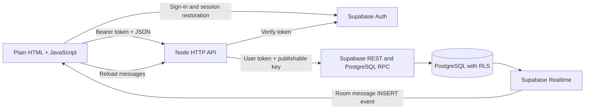

# Multiplay — watch-together-anything

A watch-together app for couples. Many couples can use the system; each private room has **at most two members**. User IDs are added through room creation and invitation, never hard-coded in the schema. An account can currently belong to multiple rooms.

This is a working development backend with a plain HTML starter. Authentication, profiles, rooms, invitations, saved chat, and live chat work. Movie discovery, shared lists, playback synchronization, watched tracking, and calls are still being built.

## Requirements and implementation status

The intended experience lets both partners control playback, maintain a shared movie/show list, chat or call, and move titles to Watched after finishing together. Episode progress must be distinguished from completing a series. Development aims to use free services; production cost and capacity are not established.

| Feature | Status | Notes |
| --- | --- | --- |
| Plain HTML starter | Done | No CSS or build step; visual design is left to the frontend developer. |
| Local demo | Done | In-memory catalog, list, room state, and chat for frontend work with Node off; resets on reload. |
| Email/password sign-in | Done | Supabase session restoration/refresh; Node verifies access tokens. |
| Editable profiles | Done | Display name and avatar persist in PostgreSQL. |
| Room creation/invitation | Done | Database functions create membership; trigger enforces two members per room. |
| Joined-room list/selection | Done | Member-only list; connection and selection preferences use local storage. |
| Saved text chat | Done | Latest 100 messages; verified sender; duplicate client message IDs ignored on retry. |
| Live chat | Done | Room-filtered Supabase Postgres Changes events trigger message reloads; manual refresh remains available. |
| TMDB browsing/search | Pending — next priority | Token setup discussed; no TMDB backend integration yet. |
| Shared movie/show list | Pending | Frontend demo/contract scaffolding only; no real list table or endpoints. |
| Shared playback | Pending | No persisted session/command API or verified player synchronization. Both members should have control. |
| Watched completion | Pending | Needs both-member confirmation, episode progress, and undo. |
| Voice/video | Pending | No WebRTC signaling or STUN/TURN setup. |
| Public signup/recovery | Pending | Only sign-in UI exists; create test accounts in Supabase Dashboard. Check project signup settings separately. |
| Production deployment | Pending | Node listens only on 127.0.0.1:3000. |

## System design



- **Frontend:** index.html with inline JavaScript and the Supabase browser SDK from jsDelivr. Local demo stays available for independent frontend work.
- **Backend:** Node native http, fetch, fs, and path; CommonJS modules. The installed dependency is @supabase/server for token verification. No framework or ORM.
- **Database:** Supabase PostgreSQL. Node forwards the user's token to REST/RPC calls, so Row Level Security (RLS) applies. This implementation does not use a service-role/secret key.
- **Realtime:** Browser subscriptions listen for inserts in the selected room. Events cause an authenticated API reload; PostgreSQL retains the messages. RLS controls readable records.
- **Planned:** TMDB metadata/search/posters, room-scoped shared lists, playback sessions, external-player adapters, and WebRTC calls.

### Main flows

1. **Sign in:** Supabase Auth supplies a session. /api/me verifies it and reads or creates the user's profile. Requests retrieve the current session rather than retaining an expired token.
2. **Create room:** Node calls create_watch_room. One database transaction creates the room, generates a random 12-character invite code, and adds the creator as a member.
3. **Join room:** join_watch_room finds the code and locks the room row before inserting membership. A trigger uses a transaction lock and count to enforce the two-member limit.
4. **Send chat:** Node checks membership, derives sender ID from verified claims, reads their name, validates text, and inserts it. The combination of room ID, sender ID, and client message ID prevents duplicate inserts on retry.
5. **Receive chat:** A Realtime event triggers an API fetch. Room changes/sign-out remove the old subscription. Generation/request checks prevent stale responses from replacing another room's chat.

## Repository map

```text
index.html                 HTML UI, demo/mock backend, auth and Realtime client
backend/server.js          HTTP server, root page, profile and room APIs
backend/chat.js            Chat API, membership checks and validation
backend/schema.sql         Tables, RLS, RPCs, capacity trigger, Realtime publication
backend/package.json       Backend dependencies
backend/package-lock.json  Locked dependency versions
.gitignore                 Excludes .env files and node_modules
```

## Setup from a fresh clone

Use Node.js 22 (development used 22.14.0), npm, and a Supabase project. Run commands from the repository root:

```powershell
npm ci --prefix backend
```

Create a root .env file locally:

```dotenv
SUPABASE_URL=https://YOUR_PROJECT.supabase.co
SUPABASE_PUBLISHABLE_KEY=YOUR_PUBLISHABLE_KEY
# Planned TMDB integration; currently unused by backend code:
# TMDB_READ_ACCESS_TOKEN=YOUR_TMDB_READ_ACCESS_TOKEN
```

The browser also has SUPABASE_URL and SUPABASE_PUBLISHABLE_KEY constants in index.html. If using a different Supabase project, update both those constants and .env. A publishable key may be used in browser code. Never put a Supabase secret/service-role key or TMDB token in HTML or commit .env.

A fresh clone does not include the previous checkout's .env or installed dependencies. Keep local configuration in the checkout you actually run.

1. Run the full backend/schema.sql in Supabase SQL Editor.
2. Create test email/password accounts under Supabase Authentication → Users. They must be able to sign in under the project's email-confirmation settings.
3. Start Node from the repository root:

   ```powershell
   node --env-file=.env backend/server.js
   ```

4. Open [http://127.0.0.1:3000/](http://127.0.0.1:3000/), sign in, select **Backend API**, leave Backend origin blank, and Connect.
5. Create a room. In a second browser/profile, sign into a second account and join by code.

Restart Node after backend or .env edits. Hard-refresh after HTML changes; Node reads the file for each page request. Keep a consistent origin: localhost and 127.0.0.1 have separate browser session/preference storage.

The schema supports reapplication during development through IF NOT EXISTS and policy/function replacement. It also contains legacy upgrades dropping the old singleton room flag and obsolete unique-user constraint. Review before applying to populated environments. There is no versioned migration runner.

### Local demo and Backend API

- **Local demo:** core mock workflows use in-memory samples without Node. The page still loads the Supabase SDK from a CDN; real sign-in checks require the backend.
- **Backend API:** real profiles, rooms, and messages. Connect saves mode/origin preferences. Movie/list/player demo controls do not become real APIs in this mode.
- The supported setup serves HTML and API from the same Node origin. Despite the Backend origin input, CORS/OPTIONS support is not implemented. The sign-in check also assumes localhost/127.0.0.1 on port 3000.
- 127.0.0.1 refers to the browser's machine. A partner on another computer cannot reach this local server without deployment or deliberate network and URL changes.

## Implemented HTTP API

Except for / and /api/health, send:

```http
Authorization: Bearer <Supabase user access token>
apikey: <Supabase publishable key>
Content-Type: application/json
```

Content-Type is needed for JSON bodies. Errors use an object with an error string. Chat also explicitly checks room membership.

| Method | Path | Request | Successful response |
| --- | --- | --- | --- |
| GET | / | — | HTML starter |
| GET | /api/health | — | {status:"ok"} |
| GET | /api/me | — | {userId,profile:{displayName,avatarKey},groupId:null,roomId:null} |
| PATCH | /api/me/profile | {displayName,avatarKey} | {profile:{displayName,avatarKey}} |
| GET | /api/rooms | — | {items:[{roomId,name,inviteCode}]} |
| POST | /api/rooms | {name}; defaults if omitted | 201 {roomId,name,inviteCode,createdBy} |
| POST | /api/rooms/join | {inviteCode} | {roomId,name,createdBy} — caveat below |
| GET | /api/rooms/{roomId}/messages | — | {items:[{id,senderId,senderName,body,sentAt}]} |
| POST | /api/rooms/{roomId}/messages | {clientMessageId,body} | 201 {sent:true} |

Profile names are trimmed and limited to 1–40 characters. Avatar keys: moon, sun, star, heart. Messages are trimmed and limited to 1–2000 characters; client message IDs must be UUIDs. Chat reads return the latest 100 messages in chronological order, without older-message pagination.

Contract caveats:

- /api/me still returns null groupId/roomId placeholders. Choose a room using /api/rooms.
- The join response's createdBy currently contains the requesting user's ID, not necessarily the creator. Correct it before relying on that field for ownership.
- The Backend contract block inside index.html contains proposed routes and some outdated response shapes. The table above describes actual routes. Catalog/search, group lists, room state/media/commands/presence, and session-completion APIs are **not implemented** and return 404.

## Database model and access

| Object | Purpose |
| --- | --- |
| auth.users | Supabase-managed identities |
| profiles | One profile per user; users read/insert/update their own row |
| watch_rooms | Room ID, name, creator, invite code, creation time; members can read |
| watch_room_members | Room/user membership and join time; members can read membership in their room |
| watch_room_messages | Text, sender ID/name snapshot, client message ID, room ID, timestamp; member-only reads and self-sender member inserts |
| create_watch_room(text) | Authenticated RPC for room and creator membership |
| join_watch_room(text) | Authenticated RPC to join by code |
| is_room_member(uuid) | Membership helper for RLS |
| enforce_room_capacity() | BEFORE INSERT trigger enforcing two members |

RPC/helper functions use SECURITY DEFINER, an empty search path, and explicit schema references. Creation/join execution is granted to authenticated users. Preserve authentication/membership checks when extending these functions: their owner privileges can bypass ordinary RLS.

Message text is rendered with textContent. It is stored as plain text in Supabase; the app does not implement end-to-end encryption. Names are snapshots, so old messages retain the name used when sent.

### Realtime setup and troubleshooting

The end of schema.sql adds watch_room_messages to supabase_realtime without resetting other published tables. Verify using:

```sql
select pubname, schemaname, tablename
from pg_publication_tables
where pubname = 'supabase_realtime'
  and schemaname = 'public'
  and tablename = 'watch_room_messages';
```

A connected channel does not prove database-event delivery. The page displays database-listener status/errors. If manual refresh works but live delivery fails, check this publication, the selected room, and SELECT RLS permissions. Do not disable RLS as a workaround.

## Remaining work and suggested order

1. **TMDB — current next task:** backend catalog/search, movie/TV metadata, posters, details and pagination. Keep TMDB_READ_ACCESS_TOKEN server-side. Setup was discussed, but the repository supplies no credential or working integration. Include required TMDB attribution before publishing.
2. **Room-scoped shared list:** tables, RLS, add/remove titles and live updates. Replace the proposed groupId contract or deliberately implement groups; do not rely on the null placeholder.
3. **Playback sessions:** persist title/episode, status, position/time anchor and revision. Authorize both members, validate commands, handle duplicate/stale commands, and recover on reconnect.
4. **Player adapters:** Cinemaos is the intended primary provider, VidLink the fallback. Existing iframe/postMessage code is experimental; provider contracts and cross-client synchronization are unverified. Check origins, supported events, readiness, drift correction and fallback. Metadata does not guarantee a playable title.
5. **Watched progress:** require both partners' confirmation, track episodes separately from whole series, and support undo.
6. **Voice/video:** WebRTC plus authenticated signaling, permissions, connection recovery and STUN/TURN. No call backend exists; free relay capacity is not guaranteed.
7. **Product/operations:** frontend design, signup/confirmation/password reset, invite rotation/expiry, room departure/deletion, rate limits, deployment, configuration, monitoring and service quota checks.

## Known limitations and validation

- There are no committed automated tests, CI workflow, or migration history. Prior checks used syntax validation, mocked auth/chat/Realtime checks, and manual two-account flows. The developer reported profiles, rooms, saved chat, and live chat working; recheck against your own Supabase project.
- Rejoining an already joined full room can hit the BEFORE INSERT capacity trigger before ON CONFLICT DO NOTHING. Handle existing membership explicitly before inserting.
- Profiles default to avatar_key='default', but the form/save route accepts moon/sun/star/heart. Align defaults. The HTML name input allows 60 characters while the API accepts 40.
- Newly created/joined rooms set the active ID but do not repopulate the selector until reconnect. Reconnecting chooses a remembered room or the first returned room.
- Invite codes have no expiry/rotation; there are no application rate limits or room-count limits. Members can read their room's invite code.
- Supabase configuration is duplicated in .env and browser constants. Authentication and JSON parsing are duplicated across routes and should be extracted as the backend grows.
- Some controls in the starter call future APIs. A visible control or successful demo action is not proof of a real backend feature.

## Working agreement

Keep Local demo available for independent frontend work. Preserve element IDs unless updating their JavaScript handlers too. Keep the starter CSS-free until the frontend developer adds the intended design. Work in the actual cloned repository, keep credentials out of Git, and update this README whenever APIs or schema change.
